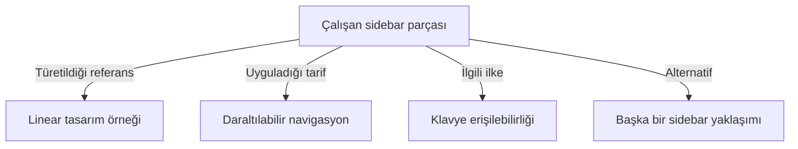
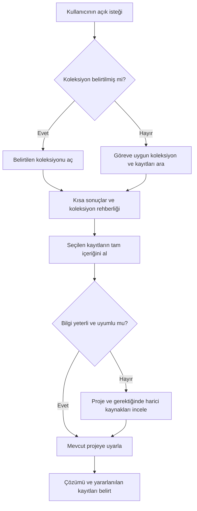

# The Useful Parts — Product Requirements Document

## Sürüm 1 özeti

The Useful Parts, dijital ürün geliştirirken işe yarayan görsel, kod, doküman ve skill'leri saklamak ve sonraki projelerde yeniden kullanmak için kişisel bir kütüphanedir. Sürüm 1'de tek kullanıcı:

- İçeriği hızla Inbox'a veya bir koleksiyona kaydeder, düzenler ve arayarak bulur.
- Görseli yorumlarıyla inceler, kodu veya doldurduğu şablonu kopyalar ve çok dosyalı içeriği özgün yollarıyla indirir.
- Codex veya Claude Code'a açık istekle kütüphanede arama, okuma ve izinli katkı yaptırır.
- Kütüphanenin tamamını veya bir koleksiyon ağacını dosyalarıyla dışa aktarır.

**Belgeyi okuma sırası**

- **MVP kapsamı (§13).** FR-01–FR-34, Sürüm 1'de teslim edilecek gereksinimlerin dizinidir. Ürün davranışlarının ayrıntıları §6–§7, §9–§10 ve §12'de tanımlanır. §8 bu davranışları örnek akışlarla gösterir.
- **Teknik doğrulama ve teslim (§14.0–§14.1).** MCP prototipi istemci yeteneklerini sınar. D1–D4, davranışların ne zaman kullanılabilir hâle geldiğini ve gereksinimlerin ne zaman tamamlandığını gösterir.
- **Kabul ve ürün doğrulaması (§15).** V-01–V-23, ilişkili FR'lerin hangi davranışlarının sınandığını gösterir. §15.1 ve §15.3 gerçek kullanımda elde edilen faydayı değerlendirir.
- **Sürüm sınırları (§14.2–§14.4).** MVP sonrası öncelikli adaylar ve ihtiyaca bağlı fırsatlar §14.2–§14.3'te, ürünün hedef dışı alanları §14.4'tedir.

Terimler [GLOSSARY.md](../GLOSSARY.md) dosyasında, kabul edilmiş kararlar [ADR'lerde](adr/), uygulama seçimleri [TECH-STACK.md](TECH-STACK.md) dosyasında ve ürün referansları [REFERENCES.md](REFERENCES.md) dosyasındadır.

## 1. Ürün vizyonu

**The Useful Parts, dijital ürün geliştirirken işe yarayan bilgi ve parçaları tekrar kullanmak için kişisel bir kütüphanedir.** Kullanıcı bir görseli, teknik çözümü, doküman şablonunu veya skill'i, sonraki görevlerde kendisi kullanmak veya bir ajana kullandırmak üzere saklar.

### 1.1. Ürün vaadi

> Faydalı olanı bir kez keşfet, kendi kütüphanende sakla, farklı projelerde kendin veya farklı ajanlarla tekrar kullan.

## 2. Problem tanımı

- Görseller, kod, notlar ve şablonlar farklı araçlara dağılır. Kullanıcı ve ajanlar daha önce bulunan bilgiyi yeniden arar.
- Bir örnek, neden saklandığı ve hangi koşullarda işe yaradığı kaydedilmedikçe sonraki projede yanlış uygulanabilir.
- Proje veya ajan istemcisi değiştiğinde kullanıcının tercihleri, kararları ve işe yarayan parçalar geride kalır.

## 3. Hedef kullanıcı ve kullanım kapsamı

### 3.1. Birincil kullanıcı

İlk sürüm, kendi dijital ürünlerini geliştiren tek bir kullanıcı içindir. Kullanıcı tasarım ve uygulama örneklerini toplar, geçmiş çözümlerini ve şablonlarını saklar, bunları farklı projelerde kendi başına veya Codex ve Claude Code gibi ajanlarla kullanır.

### 3.2. Bilgi alanları

Ürünün kapsamı **dijital ürün geliştirmede yeniden kullanılabilecek kişisel bilgi ve referanslardır**. Design, Engineering, Product ve AI & Workflows birinci sınıf bilgi alanlarıdır. Her alan kendi ihtiyaçlarına uygun özellikler sunabilir; bilgi modeli bu dört alanla sınırlı değildir.

| Alan | Örnek içerikler |
| --- | --- |
| Design | Bileşenler, ekranlar, kullanıcı akışları, etkileşimler, düzenler, tipografi, görsel yaklaşımlar |
| Engineering | oRPC, TanStack Query, authentication, mimari, kod parçaları, tarifler, test stratejileri |
| Product | Ürün geliştirme yaklaşımları, PRD örnekleri, keşif yöntemleri, teknik karar verme yöntemleri, UX araştırmaları |
| AI & Workflows | Prompt ve parametreli şablonlar, skill’ler, ajan talimatları, ajanlarla çalışma yöntemleri ve yeniden kullanılabilir iş akışları |
| Alanlar arası deneyimler | Başarısız deneyimlerden çıkarılan dersler, anti-pattern'ler, erişilebilirlik, tasarım ile yazılım arasındaki ilişkiler |

Dört alan başlangıçta oluşturulur; kullanıcı alanları kendi ihtiyacına göre düzenleyebilir ve yeni alanlar oluşturabilir. Alanlar içerik türünü veya özelliklerini sınırlayan ayrı veri sistemleri değildir. Genel kişisel not tutma, her türlü dijital dosyayı arşivleme ve görev yönetimi ürünün merkezinde değildir.

### 3.3. Alanlara özgü değer ve kapsam sınırları

| Alan | Çözülen temel ihtiyaç | MVP'de özgül deneyim | Ürün sınırı |
| --- | --- | --- | --- |
| Design | Seçtiğim görselleri, hangi parçalarını neden beğendiğimi ve uygulanabilir tasarım bilgisini tekrar kullanmak | Görsel galeri, asıl görsel, bölgeye bağlı yorum, kaynak ve tutum; ilgili teknik parçaya erişim | Tam tasarım editörü veya genel hazır tasarım kataloğu değil |
| Engineering | Kod, teknik tarif, karar, standart ve çalışan parçayı bağlamıyla kullanmak | Kod/dosya ağacı, klasör/ZIP yükleme, kopyalama/indirme/paketleme, kullanım örneği, statik görsel veya demo bağlantısı, uyumluluk ve doğrulama | IDE, paket yöneticisi, CI veya API test aracı değil |
| Product | Ürün geliştirme yöntemlerini, örnekleri, şablonları, karar gerekçelerini ve öğrenilen dersleri projeler arasında taşımak | Doküman referansı ile uygulanabilir şablonu ayırt etme, şablon kopyalama veya parametre doldurma; kaynak ve karar ilişkileri | Tam proje yönetimi, roadmap/backlog veya araştırma operasyonu aracı değil |
| AI & Workflows | Prompt, skill, ajan talimatı ve iş akışlarını farklı görevlerde/ajanlarda kullanmak | Hızlı erişim/kopyalama, parametreli metin şablonu, çok dosyalı skill'i klasör/ZIP ile yükleme, inceleme ve indirme, workflow içeriğini saklama | Ajan çalıştırma veya workflow orkestrasyon platformu değil |

Özelleşmiş özellikler mümkün olduğunca içeriğin niteliğine ve kullanım amacına bağlıdır, alan adına değil. Örneğin bir sidebar bileşeni hem Design hem Engineering koleksiyonlarında bulunabilir. İkisinde de aynı kayıt, kod, görsel ve metadata korunur; ilgili görünüm farklı bilgileri öne çıkarabilir. Parametreli bir metin şablonu Product, Engineering veya AI & Workflows için de kullanılabilir.

Projeye özgü bir bulgu veya gereksinim kaydedilebilir ve ilgili proje bilgisi kaynak/kapsam olarak korunabilir. Projeler arası yeniden kullanılabilir bilgi ile tek bir proje için geçerli çalışma bağlamı birbirine karıştırılmaz. İlk sürümde kapsam bilgisi, kaynak ve koleksiyonlar bu ayrımı ifade eder; ayrı bir Projects modülü geliştirilmez. Bir Space veya koleksiyon ağacı, proje dizinine konabilecek bir koleksiyon paketi olarak indirilebilir (§12.2).

## 4. Değer önerileri ve ürün ilkeleri

### 4.1. Temel değer

Kullanıcı bir kaydı az sürtünmeyle ekler, asıl içeriği ve kendi gerekçesini daha sonra bulur, ilgili parçayı projesine taşır. Ajan aynı kayda görevle sınırlı biçimde ulaşabilir.

### 4.2. Ürün ilkeleri

1. **Önce kaydet, sonra zenginleştir.** Metadata, ilgili kayıt bulunup kullanıldıkça eklenebilir.
2. **Asıl içeriği ve bağlamını koru.** Kaynak, kişisel not, ajan katkısı ve doğrulama koşulları ayırt edilebilir olmalı.
3. **İnsan ve ajan aynı bilgiyi kullanır.** Ortak kayıt ve arama modeli, içeriğe uygun kopyalama, indirme ve inceleme eylemlerini destekler.
4. **Kullanıcı tercihlerini kendisi belirler.** Bir kaydın nasıl kullanılacağına tutumu, kapsamı ve projenin koşulları birlikte yön verir.
5. **Kapsamı gerçek kullanımla büyüt.** Yeni bir yetenek toplama, keşif, bağlamı koruma veya yeniden kullanma sırasında gözlenen bir güçlüğü çözmeli.

## 5. Benzer ürünler ve farklılaşma

[REFERENCES.md](REFERENCES.md) ilham alınan ürünleri, resmî kaynakları ve doğrulama notlarını içerir.

### 5.1. Farklılaşma hipotezi

Aynı kişisel kütüphane, ilişkili bir görsel referansı ve teknik yaklaşımı hem doğrudan yeniden kullanıma hem de farklı ajanların erişimine açabilir. Hipotez, bu ortak erişimin gerçek projelerde aramaya harcanan zamanı ve yeniden yapılan işi azaltmasıdır. §15.3'te sınanır.

## 6. Bilgi mimarisi ve kavramsal model

### 6.1. Temel kavramlar

Kavramların kanonik tanımları ve kaçınılacak eş anlamlılar [GLOSSARY.md](../GLOSSARY.md) dosyasındadır; bu PRD terimleri orada tanımlandığı anlamda kullanır ve tanımları tekrar etmez. Terimlerin anlamı değiştiğinde önce GLOSSARY güncellenir. Geri alınması zor ve gerekçesi bağlam olmadan anlaşılmayacak kararlar [docs/adr/](adr/) altında kaydedilir.

Ürün açısından temel kavramlar: Library, Space, Collection, Membership, Item, Item type, Content, Source, Tag, Relationship, Inbox, Trash, Stance, Lifecycle, Maturity, Validity, Origin, Agent connection, Collection package. Bu PRD'nin yapısını belirleyen üç karar:

- **Space bir kök koleksiyondur** ([ADR-0001](adr/0001-space-kok-koleksiyondur.md)). Kayıtlar doğrudan Space'e üye olabilir; üyelik, arama, taşıma/silme ve MCP kuralları aynıdır.
- **Kayıt durumu üç bağımsız eksendir** ([ADR-0002](adr/0002-bagimsiz-durum-eksenleri.md)): yaşam döngüsü, olgunluk ve geçerlilik (§7.2).
- **Ajan yazma sınırı** ([ADR-0003](adr/0003-ajan-yazma-siniri.md)): yeni kayıt oluşturma, alt koleksiyon açma ve yalnız kendi el değmemiş Ham kaydını düzeltme (§10.6).

### 6.2. Organizasyon yapısı

```text
The Useful Parts
├── Inbox
├── Trash
├── Design
│   ├── Navigation
│   │   ├── Breadcrumb
│   │   └── Sidebar
│   ├── Forms
│   └── Data Visualization
├── Engineering
│   ├── oRPC
│   ├── TanStack Query
│   ├── Authentication
│   ├── Architecture
│   └── Testing
├── Product
│   ├── Discovery
│   └── PRD Examples
└── AI & Workflows
    ├── Prompts
    └── Agent Workflows
```

Design, Engineering, Product ve AI & Workflows varsayılan başlangıç Space'leridir. Alt koleksiyonlar örnektir; kullanıcı kendi alanlarını ve koleksiyonlarını oluşturabilir ve düzenleyebilir. Hazır bir sınıflandırma sistemini benimsemek zorunlu değildir.

Organizasyon kuralları:

- Space, üst koleksiyonu olmayan kök koleksiyondur. Diğer her koleksiyon bir Space'in veya başka bir koleksiyonun altında bulunur. Aynı üst koleksiyon altında aynı adla iki koleksiyon bulunmaz; farklı üstler altında aynı ad kullanılabilir (örneğin Design/Forms ve Engineering/Forms).
- Bir kayıt doğrudan bir Space'e veya bir koleksiyona üye olabilir; birden fazla koleksiyona, gerektiğinde farklı Space'lerdeki koleksiyonlara üye olabilir.
- Bir kayıt için ilgili birden fazla koleksiyon olduğunda içerik kopyalanmaz. Aynı kayıt, ortak kimliği ve güncel içeriğiyle farklı yerlerde gösterilir.
- Bir kayıt herhangi bir koleksiyona henüz eklenmemiş olabilir. Inbox, hiçbir koleksiyona (Space dahil) üyeliği olmayan aktif kayıtların görünümüdür ve hızlı kaydetmeyi mümkün kılar.
- Koleksiyon, alt ağacıyla birlikte başka bir Space veya koleksiyonun altına taşınabilir. Koleksiyon silme ve taşıma kuralları §7.5'tedir.
- Etiketler koleksiyon üyeliğinin yerine geçmez; farklı koleksiyonları kesen özellikleri belirtmek ve arama yapmak için kullanılabilir.
- Üst ve alt koleksiyonlar arasında gezinme ve kapsamlı arama mümkündür. Doğrudan bir alt koleksiyona yapılan sorgu ilgisiz koleksiyonları kendiliğinden kapsamaz.
- Bir koleksiyonu açmak, alt koleksiyonları ve doğrudan üye aktif kayıtları gösterir; alt koleksiyonlardaki kayıtlar otomatik olarak bu listeye eklenmez. Koleksiyon kapsamında arama ise varsayılan olarak bütün alt koleksiyonları kapsar. Kullanıcı veya ajan, aramayı yalnızca doğrudan üyeliklerle sınırlandırabilir. Birden fazla eşleşen üyeliği olan kayıt arama sonucunda bir kez gösterilir. İnsan ve ajan tarafında aynı kapsam mantığı geçerlidir.
- Koleksiyon üyeliğini kaldırmak ile kaydın kendisini silmek ayrı işlemlerdir. Bir organizasyon değişikliği, başka koleksiyonlarda kullanılan içeriğin kaybolmasına neden olmamalıdır.

### 6.3. Kayıt türleri

Kayıt türü, içeriğin nasıl kullanılabileceğini anlamaya ve uygun sunumu seçmeye yardımcı olur. İçerik biçimiyle aynı kavram değildir.

| Tür | Amaç | Örnek |
| --- | --- | --- |
| Referans (Reference) | İncelenecek örneği veya harici bilgiyi saklamak | Stripe breadcrumb görseli, GitHub dokümanı, iyi bir PRD örneği |
| Tarif (Recipe) | Bir problemi çözmek için uygulanabilir yaklaşımı aktarmak | oRPC ile cursor tabanlı sayfalama |
| Yeniden kullanılabilir parça (Reusable Part) | Uygulanabilecek veya uyarlanabilecek somut bir çıktı saklamak | React sidebar bileşeni, çok dosyalı yardımcı araç, prompt, skill, PRD şablonu |
| İlke / Karar (Principle) | Gerekçesiyle birlikte bir kural, standart veya alınmış kararı ifade etmek | Form hatalarının kullanıcı etkileşimiyle ilişkili gösterim kuralı; bir projede belirli bir kimlik doğrulama yaklaşımının seçilme kararı ve gerekçesi |
| Not (Note) | Henüz türü kesinleşmemiş ya da yapılandırılması gerekmeyen bilgi saklamak | Bir bağlantı, araştırma notu veya ham kod parçası |

İlke / Karar türü bir kaydın bağlayıcı olduğunu göstermez; bağlayıcılığı yalnızca kullanıcının belirlediği tutum ifade eder (§7.1). Örneğin tutumu Belirtilmemiş olan bir karar kaydı, yalnızca geçmişte alınmış bir kararın belgesidir.

Kayıt türleri kütüphaneyi ayrı veri adalarına bölmez. Bir referanstan bir tarif, bir tariften yeniden kullanılabilir bir parça türetilebilir. Bir kayıt yeterli olduğunda içeriğin yapay olarak birden fazla kayda bölünmesi gerekmez. Kullanıcı bir kaydın türünü değiştirebilir veya ondan yeni, ilişkili bir kayıt oluşturabilir.

Genel kayıt türü korunur; özelleşmiş içerik biçimi, kaydın içeriğiyle nasıl etkileşime girileceğini belirler. Örneğin `Reusable Part` olarak saklanan bir kayıt çok dosyalı bileşen, prompt, skill veya doküman şablonu olabilir. `Recipe` teknik veya ürün geliştirme yöntemi; `Reference` ekran görüntüsü veya örnek PRD; `Note` ham not veya araştırma bulgusu olabilir. Bu biçimler alanlara kilitli değildir ve ayrı kayıt sistemleri oluşturmaz. Bir karma kayıt birden fazla biçime uygun içeriği taşıyabilir. Tür veya özelleşmiş biçim seçimi baştan zorunlu değildir.

### 6.4. Ortak kayıt özellikleri

| Özellik | Açıklama |
| --- | --- |
| Kimlik, başlık | Kaydı benzersiz biçimde tanıma ve tekrar bulma. |
| Tür, kısa açıklama ve içerik biçimi | Kaydın doğası, neyle ilgili olduğu ve içeriğe uygun eylem/sunum; arama sonuçlarında yararlı özet. |
| İçerik | Metin, kod, görsel, medya, bağlantı ve dosyaların bir arada bulunabileceği esnek yapı. |
| Koleksiyonlar, etiketler | Kullanıcının seçtiği organizasyon ve keşif özellikleri. |
| Kaynaklar | URL, proje veya doküman bilgisi; varsa özgün içerikle ilişki. |
| Kişisel not | Kullanıcının hangi kısmı neden sakladığı, nasıl değerlendirdiği. |
| AI açıklaması / analizi | Varsa ajanın veya AI hizmetinin ürettiği, kullanıcı notundan ayrı bilgi. |
| Köken ve tarihler | Kaydı ve içerik parçalarını kullanıcının mı, hangi ajan bağlantısının mı ürettiği; oluşturulma ve güncellenme zamanı. |
| Kullanım amacı ve kapsamı | Nerede faydalı olduğu, hangi bağlamda kullanılabileceği. |
| Kullanıcı tutumu | Referans, tercih, kural, alternatif veya olumsuz örnek gibi açık değerlendirme. |
| Durum | Birbirinden bağımsız üç eksen: yaşam döngüsü (Aktif, Arşivlenmiş, Trash), olgunluk (Ham, İncelenmiş) ve geçerlilik (Belirtilmemiş, Doğrulanmış, Yeniden doğrulanmalı, Geçerliliğini yitirmiş) (§7.2). |
| İlişkiler | Diğer kayıtlarla bağlantılar. |
| Teknik uyumluluk ve doğrulama | Gerekli olduğunda sürüm, stack, doğrulama adımı ve doğrulama tarihi. |

Bu tablo kavramsal gereksinimleri tanımlar; veritabanı şeması değildir. Bir kayıt hızlı oluşturulabilmek için yalnızca paylaşılabilir içeriğe ihtiyaç duyar. Başlık, URL'den veya dosyadan türetilebilir. Kişisel not, etiket, koleksiyon, durum, teknik uyumluluk ve benzeri bilgiler sonradan eklenebilir.

Ortak özelliklerin anlamları korunur; her kayıtta bütün özellikler aynı anda gösterilmez. Örneğin görselde kaynak ve yorum; tarifte kod, kullanım koşulu ve doğrulama; prompt'ta metin, değişken ve kopyalama; skill'de açıklama ve dosya yapısı öne çıkar. İhtiyaç duyulan ek metadata sonradan açılıp düzenlenebilir. Kullanılabilir metin şablonları MVP'de desteklenir (§6.8).

### 6.5. İçerik ve medya

- Bir kayıt bir veya birden fazla görsel, metin bölümü, kod bloğu, bağlantı ya da dosya içerebilir.
- Kod parçaları gerektiğinde dil, dosya adı veya göreli dosya yolu ve kullanım bağlamıyla saklanabilir. Bir tarif, birden fazla dosyayı birlikte içerebilir.
- Ekran görüntüleri ve diğer görsel referanslarda asıl görselin veya izin verilen bir kopyasının erişilebilir olması önemlidir.
- Video, etkileşim kaydı veya başka bir dosya başlangıçta ek dosya ya da bağlantı şeklinde saklanabilir.
- Kaynak URL'si mevcutsa korunur. Kullanıcıya ait özgün bir çözümün harici URL'si olmak zorunda değildir; kendi proje bilgisi, commit veya kullanılan doküman gibi kaynaklar belirtilebilir.
- Yalnızca bağlantı tutulan kayıtlar geçerli kayıtlardır. Harici içeriğin bir kopyasını saklamak, erişim izinlerine ve kaynak kullanım koşullarına uygun olduğu durumlarda mümkündür.

- Çok dosyalı içerik, web uygulamasına bir klasör veya ZIP dosyası sürüklenerek tek seferde eklenebilir; dosyaların klasör içindeki göreli yolları korunur. `.git/`, `node_modules/`, `.DS_Store` gibi sistem ve bağımlılık dosyaları otomatik olarak atlanır ve kaydetmeden önce atlanan dosyalar kullanıcıya listelenir.
- Çok dosyalı içerikte dosyaların adları ve varsa göreli yolları korunur. Kullanıcı dosya ağacını inceleyebilir, metin/kod dosyasını kopyalayabilir, dosyayı indirebilir veya kaydın saklanmış dosyalarını tek paket halinde özgün klasör düzeniyle alabilir. Bağlantı olarak tutulan ve saklanmamış dosya indirilmiş gibi gösterilmez. Ajan da gerekli dosyaları aynı yollar ve tam içerikleriyle alabilir (§10.4).
- Kullanıcı bir görselin üzerinde basit dikdörtgen bölgeler işaretleyebilir ve her bir bölgeye kişisel metinsel yorum ekleyebilir. Orijinal görsel korunur; yorumun hangi görsel ve bölgeye ait olduğu hem insan hem ajan tarafından anlaşılabilir. Bölge yorumu kullanıcının kişisel değerlendirmesidir; MVP'de ajanlar bölge yorumu oluşturmaz. Bu yorum, ekranın tamamının veya görseldeki başka parçaların kullanıcı tercihi olduğu anlamına gelmez. Tam çizim/canvas editörü değildir.
- Yeniden kullanılabilir bileşen için kaydedilmiş görüntü/GIF veya harici demo bağlantısı, kaynak kodu, kullanım örneği, uyumluluk, doğrulama ve tasarım referansları varsa birlikte incelenebilir. Bu görünüm, kodun uygulama içinde çalıştırıldığı veya harici demonun doğrulandığı izlenimini vermemelidir.

### 6.6. Koleksiyon bilgisi

Koleksiyonlar yalnızca öğeleri gruplamaz. Kendi başlıkları, açıklamaları, amaçları, notları, varsayılan görünümleri ve gerekirse genel rehberlik bilgileri olabilir.

Örneğin Breadcrumb koleksiyonundaki bir not, kullanıcının belirli hiyerarşi davranışlarına ilişkin tercihini ifade edebilir.

Koleksiyon rehberliği, yalnızca ilgili örnekleri görmekten daha fazla bağlam sağlarken kayıt seviyesindeki bilgilerin yerini almaz.

### 6.7. Kayıtlar arası ilişkiler

İlişkiler, bir kaydı kopyalamadan başka bir bilgiyle bağlantı kurmayı sağlar. Örnek ilişkiler:

- İlişkilidir (related to).
- Şu referanstan türetilmiştir (derived from).
- Şu yaklaşımı uygular (implements).
- Şu yaklaşıma alternatiftir (alternative to).
- Şu eski çözümün yerini alır (supersedes).

Bir ilişki, hedef kaydı otomatik olarak açmak veya uygulamak anlamına gelmez. Kullanıcı ve ajan, gerektiğinde ilgili kayda geçebilir. İlişkinin kökeni korunur; ajanın yeni kayıtla birlikte kurduğu ilişki ajan kökeniyle görünür ve hedef kaydı değiştirmez.



### 6.8. Uygulanabilir metin şablonları, prompt ve skill

- **Doküman şablonu:** Bir örnek PRD incelenecek referans olabilir; kullanıcının kendi PRD şablonu ise yeni doküman üretmek için tekrar kullanılabilir içeriktir. Kullanıcı şablon metnini kopyalayabilir veya ajana sunabilir; işlem özgün kaydı değiştirmez. Ayrı doküman üretme uygulaması gerekmez.
- **Parametreli metin:** Bir prompt, brief, teknik tarif veya doküman şablonu basit `{{name}}` ve isteğe bağlı `{{name:default}}` benzeri değişkenler içerebilir. Kullanıcı değişken değerlerini doldurur ve elde edilen metni kopyalar; özgün şablon korunur. Değişken tanımları ve varsayılanlar ajan tarafından da okunabilir. İlk sürümde koşul, döngü veya genel amaçlı şablon programlama dili bulunmaz; kesin sözdizimi teknik tasarımda belirlenir.
- **Skill:** Bir skill, kullanım koşulu/açıklama, giriş dosyası (`SKILL.md` gibi) ve referans, script veya diğer yardımcı dosyalarıyla saklanabilen bir reusable part'tır. Kaynak ve sürüm varsa korunur. Dosya yapısı okunabilir ve paket halinde indirilebilir; ajan ilgili dosyalara eksiksiz erişebilir. The Useful Parts içeriği otomatik olarak kurmaz veya çalıştırmaz. Hazır skill'in manuel kaydı ve klasör/ZIP ile yüklenmesi MVP'dedir (§6.5).
- **Workflow:** Yeniden kullanılabilir adımlar, prompt/skill ilişkileri, ön koşullar ve beklenen çıkışlar metin, kod, dosya veya ilgili kayıtlar kullanılarak saklanabilir. MVP'de ayrı workflow çalıştırma/orkestrasyon altyapısı gerekmez.

## 7. İçeriğin anlamı ve yaşam döngüsü

### 7.1. Kullanıcı tutumu ile kayıt türü farklıdır

Bir tasarım referansı kullanıcının beğendiği bir örneği, incelemek istediği bir alternatifi veya kaçınılmasını istediği bir davranışı içerebilir. Bir tarif de faydalı olmasına rağmen her projede tercih edilmeyebilir.

| Tutum | Ajan tarafından yorumlanışı |
| --- | --- |
| Belirtilmemiş | Kayıt değerlendirilmek için saklanmıştır; onay veya tercih çıkarımı yapılamaz. |
| İlham / referans | Fikir ve örnek sağlar; doğrudan kopyalanması veya uygulanması gerekmez. |
| Tercih | Uygun bağlamlarda kullanıcı tarafından tercih edilen yaklaşımı ifade eder. |
| Kural | Kullanıcı tarafından açıkça tanımlanan ve belirtilen kapsamda uygulanması beklenen rehberliktir. |
| Alternatif | Kullanılabilecek bir yaklaşımı gösterir; otomatik olarak birinci tercih değildir. |
| Kaçınılacak örnek | Geçmişte işe yaramayan veya istenmeyen davranışı gösterir. Olumlu örnek gibi sunulmaz. |

Tutum, kayıt türüne ve doğrulanmış olmasına bağımlı değildir. İsteğe bağlıdır ve yalnızca kullanıcı tarafından açıkça benimsenen değerlendirmeler kişisel tercih ya da kural olarak kabul edilir. Tutumu yalnızca kullanıcı belirler; ajanın oluşturduğu her kayıt, İlke / Karar türünde olsa bile, Belirtilmemiş tutumla oluşur.

### 7.2. Durum eksenleri: yaşam döngüsü, olgunluk ve geçerlilik

Kayıtlar ilk anda ayrıntılı olmak zorunda değildir. Bir kaydın durumu birbirinden bağımsız üç eksenle ifade edilir ([ADR-0002](adr/0002-bagimsiz-durum-eksenleri.md)); bir eksendeki değişiklik diğerlerini kendiliğinden değiştirmez. Örneğin arşivlenmiş bir tarif doğrulanmış olarak kalabilir; ajanın oluşturduğu bir kayıt Ham olduğu halde ajan tarafından aktarılmış doğrulama bilgisi taşıyabilir.

| Eksen | Değerler | Kim değiştirir |
| --- | --- | --- |
| Yaşam döngüsü | **Aktif**; **Arşivlenmiş** (olağan keşif dışında, özellikle arandığında görülebilir); **Trash** (silinmiş, geri yüklenebilir) | Yalnız kullanıcı, §7.5'teki işlemlerle. |
| Olgunluk | **Ham** (henüz incelenmemiş); **İncelenmiş** (kullanıcı tarafından değerlendirilmiş) | Yalnız kullanıcı. Yeni kayıtlar Ham başlar; kullanıcı İncelenmiş'e çekebilir veya geri alabilir. |
| Geçerlilik | **Belirtilmemiş**; **Doğrulanmış** (belirtilen ortam ve koşulda işe yaradığı bilinen); **Yeniden doğrulanmalı** (önceki doğrulama güncel içeriğe uygulanamaz); **Geçerliliğini yitirmiş** (artık veya yeni koşullarda uygun değil) | Kullanıcı; Doğrulanmış → Yeniden doğrulanmalı geçişi aşağıdaki kurallarla otomatik olur. |

Bu eksenler zorunlu bir iş akışı değildir. Örneğin bir ekran görüntüsü yıllarca Ham ve geçerliliği Belirtilmemiş olarak faydalı bir referans kalabilir. "Taslak" ayrı bir durum değildir; ajan kökenli ve Ham kayıt bu anlamı taşır ve teknik doğrulama veya kişisel tercih anlamına gelmez. Ajanın aktardığı doğrulama bilgisi ajan kökenli metin olarak saklanır; kaydın geçerlilik durumunu Doğrulanmış yapmaz.

MVP'de kullanıcı bu durumları manuel olarak yönetir. Aşağıdaki değişiklik kuralları da geçerlidir. Tarife ait kaynak, sürüm, doğrulama ve bağlam bilgileri bilinmiyorsa sistem bunları doğrulanmış gibi göstermemelidir. Geçerliliğini yitirmiş ve arşivlenmiş kayıtlar olağan aramalarda uygun güncel örneklerle karıştırılmaz; kullanıcı veya ajan geçmiş bilgiyi özellikle arayabilir.

| Doğrulanmış kayıtta yapılan değişiklik | Doğrulama davranışı |
| --- | --- |
| Başlık, etiket veya koleksiyon düzenleme | Mevcut doğrulama korunur. |
| Yaklaşımın anlamını değiştirmeyen metinsel yazım düzeltmesi | Mevcut doğrulama korunur. |
| Kod, uygulama yaklaşımı veya teknik uyumluluk bilgisi değişikliği | Kayıt yeniden doğrulanması gereken duruma geçer. Önceki doğrulama bilgisi tarih, kapsam ve doğrulama notuyla geçmiş bilgi olarak korunur; güncel içeriğin doğrulandığı izlenimi verilmez. |
| Kullanıcının güncel içeriği yeniden doğrulaması | Yeni kapsam ve tarih bilgisiyle doğrulanmış duruma dönebilir. |

Doğrulanmış bir kaydın yaklaşım metni değiştiğinde doğrulama yeniden istenir. Kullanıcı, değişiklik yalnızca yazım düzeltmesiyse mevcut doğrulamayı koruyabilir. Kod ve teknik uyumluluk değişiklikleri, önceki doğrulamayı geçersiz kılan değişiklikler olarak ele alınır. Kullanıcı veya ajan, güncel içerik için yeniden doğrulama gerektiğini kayıt detayında görebilir.

### 7.3. İçerik sahipliği ve kökeni

Özgün kaynak, kullanıcı notu, ajan tarafından üretilen içerik ve AI zenginleştirmesi birbirinden ayırt edilebilir olmalıdır. Kullanıcı, AI önerisini benimserse bunu açıkça kendi tercihine veya bir kurala dönüştürebilir.

Mevcut kişisel notlar ve kurallar, otomatik analizlerle sessizce değiştirilmez. Bir kayıt, koleksiyon, ilişki veya içerik parçası ajan tarafından oluşturulduğunda hangi ajan bağlantısının oluşturduğu korunur.

### 7.4. Kullanımla öğrenme

Ajanın bir kaydı kullanmış olması, kullanıcının onu tercih ettiğinin otomatik kanıtı sayılmaz.

### 7.5. Koleksiyon üyeliğini kaldırma, arşivleme ve silme

Kayıt işlemleri ve geri yükleme kuralları

| İşlem | Davranış |
| --- | --- |
| Remove from collection | Yalnızca seçilen koleksiyon üyeliğini kaldırır. Kayıt, diğer üyelikler, içerik, dosyalar ve ilişkiler korunur. Aktif kayıt, üyeliği kalmadığında Inbox'ta görünür. Arşivlenmiş kayıt arşivde kalır. |
| Archive | Kaydı ve bağlı bilgilerini korur, olağan keşif sonuçlarından çıkarır. Kullanıcı arşiv durumunu kaldırabilir. Arşivlenmiş bilgi özellikle arandığında kullanıcı ve ajan tarafından geçmiş bilgi olarak incelenebilir. |
| Delete | Kaydı Trash alanına taşır; normal listelerde, aramada ve ajan erişiminde artık görünmez. İçerik, kaynaklar, dosyalar, üyelikler, ilişkiler ve önceki durum geri yükleme için korunur. |
| Restore from Trash | Kaydı önceki durumuna döndürür; halen var olan koleksiyon üyeliklerini ve kayıt ilişkilerini geri yükler. Artık mevcut olmayan koleksiyon veya ilişkili kayıt yeniden oluşturulmaz; aktif duruma dönen kayıt, geçerli üyeliği yoksa Inbox'ta görünür. |
| Permanently delete | Yalnızca kullanıcının ayrıca açık onay verdiği kalıcı silme işlemiyle kayıt ve ona ait, başka kayıtlar tarafından kullanılmayan dosyalar kaldırılır. Üyelik ve ilişki referansları temizlenir; başka kayıtlar veya onların kullandığı dosyalar silinmez. İşlem kütüphane üzerinden geri alınamaz. |

Trash'teki kayıtlar kullanıcı kalıcı silmeyi seçene kadar saklanır; MVP'de otomatik kalıcı silme uygulanmaz. Arşiv ve Trash aynı durum değildir. Trash, kullanıcı tarafından yönetilir; ajanlara silme, kalıcı silme, arşivleme veya geri yükleme yetkisi verilmez.

Koleksiyon ve Space işlemleri:

| İşlem | Davranış |
| --- | --- |
| Move collection | Koleksiyon, alt koleksiyonları ve üyelikleriyle birlikte başka bir Space veya koleksiyonun altına taşınır. Kayıtlar ve üyelikleri değişmez. Bir koleksiyon kendisinin veya alt ağacının altına taşınamaz; hedefte aynı adlı kardeş koleksiyon varsa taşıma yapılmaz. |
| Delete collection | Koleksiyonu ve bütün alt koleksiyonlarını kaldırır. Kayıtları hiçbir zaman silmez; yalnızca bu koleksiyonlardaki üyelikler kalkar ve başka üyeliği kalmayan aktif kayıtlar Inbox'ta görünür. İşlemden önce etkilenecek alt koleksiyon ve kayıt sayısı gösterilerek açık onay istenir. Koleksiyonlar için Trash yoktur; işlem geri alınamaz. |

Space'ler de aynı taşıma ve silme kurallarına uyar. Bir Space başka bir koleksiyonun altına taşındığında kök konumunu kaybeder. Bir Space silindiğinde içindeki kayıtlar korunur. Ajanlar koleksiyon veya Space taşıyamaz, yeniden adlandıramaz ve silemez (§10.6).

## 8. Başlıca kullanım senaryoları

### 8.1. Tasarım referansı biriktirme ve uygulama

Kullanıcı bir breadcrumb ekran görüntüsünü kaynağı ve hangi davranışı faydalı bulduğuna ilişkin bölge yorumuyla Design / Navigation / Breadcrumb koleksiyonuna ekler. Yeni bir ekran tasarlarken koleksiyonu galeride inceler veya ajandan koleksiyona bakmasını ister. Ajan ilgili görseli ve notu açar, işe yarayan davranışı mevcut tasarım sistemine uyarlar.

### 8.2. Yazılım tarifi biriktirme ve uygulama

Kullanıcı bir projede kullandığı cursor tabanlı sayfalama tarifini kaynak dosyaları, uyumlu sürümleri ve doğrulama koşullarıyla saklar. Yeni bir endpoint geliştirirken dosyaları kendisi alabilir veya ajandan oRPC koleksiyonundaki tarifi incelemesini isteyebilir. Tarifin koşulları yeni projeye uymuyorsa yaklaşım yeniden değerlendirilir.

### 8.3. Önce bağlantıyı kaydet, sonra tarife dönüştür

Kullanıcı GitHub'da yararlı bir kod örneği bulur. Bağlantıyı Inbox'a kaydeder; o an not yazması veya koleksiyon seçmesi gerekmez. Daha sonra kaydın açıklamasını düzenler, oRPC ve Testing koleksiyonlarına dahil eder. İsterse aynı kayıt içerisinde kendi kullanım notunu tutar; isterse ilgili kaynaktan ayrı bir teknik tarif türetir ve ikisini ilişkilendirir.

Kullanıcı bir bağlantıyı ayrıntılı bir tarife dönüştürmek zorunda bırakılmaz.

### 8.4. Tasarım ve uygulama bilgisi arasında geçiş

Kullanıcı kendi geliştirdiği sidebar parçasını ilgili görsel referanslara, daraltılabilir navigasyon tarifine ve erişilebilirlik ilkelerine bağlar.

Bir ajan yalnızca görsel örneği değil, o davranışın nasıl uygulanabileceğini, hangi alternatiflerin denendiğini ve varsa çalışan kodu da bulabilir. İlgisiz kayıtları kendiliğinden yüklemek yerine ihtiyacına göre ilişkileri takip eder.

### 8.5. Ajanla geliştirilen çözümü kütüphaneye kazandırma

Kullanıcı ile ajan bir teknik problemi çözer. Kullanıcı şu isteği iletir:

> Bu çözümü, hangi koşullarda işe yaradığını da belirterek The Useful Parts'taki oRPC koleksiyonuna ekle.

Ajan, yazma yetkisine sahipse önce oRPC koleksiyonunu arayıp kimliğini bulur ve yeni bir kaydı tek seferde oluşturur; kaynakları, kodu, açıklamaları ve doğrulama bilgilerini bildiği ölçüde ekler. Koleksiyon adı belirsizse veya koleksiyon yoksa kullanıcıya sorar; kullanıcı isterse ajan mevcut bir Space veya koleksiyonun altına yeni bir alt koleksiyon açar ya da kaydı Inbox'a ekler. Kayıt Ham olarak ve ajan kökeniyle oluşur; kullanıcı onu "İncelenmemiş ajan kayıtları" filtresinde görür, inceleyip düzenleyebilir.

Kullanıcı birkaç dakika sonra "test dosyasını da ekle" derse ajan, kendi oluşturduğu ve kullanıcının henüz dokunmadığı bu Ham kaydı güncelleyebilir; ikinci bir kopya oluşturması gerekmez. Kullanıcı kayıtta ilk düzenlemeyi yaptığında veya kaydı İncelenmiş işaretlediğinde kayıt ajana kapanır (§10.6).

### 8.6. Negatif örnek ve çelişen bilgi

Kullanıcı daha önce uyguladığı fakat karmaşıklık nedeniyle vazgeçtiği bir authentication yaklaşımını kaçınılacak örnek olarak saklar. Ajan yeni bir authentication görevi sırasında bu kaydı, çözülmesi gereken problemin bağlamını ve neden kaçınıldığını anlamak için kullanabilir.

Kullanıcının tercih ettiği bir sorgu yönetimi tarifi ile mevcut projenin yerleşik mimarisi çelişirse ajan bunu değerlendirir. Önemli bir çelişkiyi gizleyerek iki yaklaşımı karıştırmak veya kütüphanedeki yöntemi zorla uygulamak yerine kullanıcıya anlamlı bir açıklama sunabilir.

### 8.7. Product doküman şablonunun yeniden kullanılması

Kullanıcı bir PRD örneğini Reference, kendi keşif/PRD şablonunu ise Reusable Part olarak saklar. Yeni bir proje başlatırken `Mod+K` ile şablonu bulur, varsa ürün ve hedef kullanıcı gibi parametrelerini doldurur, metni kopyalar veya ajana ilgili kaydı kullandırır. Ajan, kullanıcıya ait ürün geliştirme yöntemleriyle birlikte şablonu proje gereksinimlerine uyarlar. Örnek doküman ile kişisel şablon ayrımı ve şablonun orijinali korunur.

### 8.8. Prompt ve skill'in yeni görevlerde kullanılması

Kullanıcının bir referans araştırması prompt'u ve klasörünü sürükleyerek yardımcı Markdown dosyalarıyla birlikte kaydettiği bir `research` skill'i vardır. Kullanıcı prompt'u klavyeyle bulup değerlerini doldurarak kopyalar, skill'in giriş dosyasını ve referanslarını inceler, gerektiğinde özgün dosya düzeniyle paketi indirir. Kullanıcının açık isteğiyle bağlanan ajan da ilgili kayıtları ve gereken dosyaları okuyabilir. Kütüphane skill'i kendiliğinden kurmaz veya çalıştırmaz.

### 8.9. Görsel işaretleme ve doğrudan parça kullanımı

Kullanıcı dashboard referansının filtre bölgesini işaretleyip neden faydalı olduğunu not eder. Bir sidebar bileşenini ise statik önizleme, kullanım açıklaması ve kaynak dosyalarıyla saklar. Kullanıcı işaretli görseli inceleyebilir, teknik parça dosyalarını kopyalayabilir veya paketi indirebilir. Ajan verilen görsel, ilgili yorum ve kodu aynı kayıt ve ilişkiler üzerinden inceleyerek mevcut projeye uyarlar; saklanmış bir bileşeni kütüphane içinde çalıştırması gerekmez.

## 9. İnsan tarafındaki kullanıcı deneyimi

Ürün web-first bir uygulama olarak geliştirilir. Kullanıcı farklı bilgisayarlardan aynı özel kütüphaneye erişebilir. Kütüphane, herhangi bir proje dizinine veya tek bir ajan uygulamasına bağlı değildir.

### 9.1. Temel ekranlar ve gezinme

| Ekran / yüzey | Temel görevler | Kapsam |
| --- | --- | --- |
| Kütüphane / başlangıç | Space'leri, koleksiyonları, Inbox'ı, İncelenmemiş ajan kayıtlarını ve bütün kayıtları keşfetmek; hızlı ekleme ve aramaya ulaşmak | MVP |
| Space | Space'e doğrudan üye kayıtları ve altındaki koleksiyonları görmek, yeni koleksiyon oluşturmak, ilgili içerikleri keşfetmek | MVP |
| Collection | Alt koleksiyonları, açıklamayı, notları ve kayıtları görüntülemek; arama, filtreleme, düzenleme, taşıma, silme ve koleksiyon paketini indirme | MVP |
| Inbox | Organize edilmemiş kayıtları görmek, düzenlemek ve koleksiyonlara eklemek | MVP |
| İncelenmemiş ajan kayıtları | Ajan kökenli, Aktif ve Ham kayıtları görmek, incelemek ve İncelenmiş işaretlemek | MVP |
| Trash | Silinen kayıtları görmek, geri yüklemek ve ayrıca onay vererek kalıcı silmek | MVP |
| Hızlı ekleme | Bağlantı, metin, kod, görsel, dosya, klasör veya ZIP kaydetmek; kütüphane ekranlarında hızlı yapıştırma ve sürükle-bırak (§9.3) | MVP |
| Item detay ve düzenleme | Tam içerik, kaynak, notlar, koleksiyonlar, etiketler, ilişkiler, durum ve kullanım bilgileri | MVP |
| Arama | Genel ya da belirli kapsamda kayıt ve koleksiyon bulmak | MVP |
| Command Palette | Klavye ile arama, açma, uygun içeriği kopyalama, şablon doldurma ve hızlı ekleme | MVP |
| Ajan bağlantıları | Bağlantı kurma talimatları, ajan erişimi oluşturma ve yönetme | MVP |
| Ayarlar ve veri dışa aktarımı | Kütüphane ve kişisel erişim ayarları, veri export | MVP |

Bu ekranlar uygulama yapısını tarif eder; görsel tasarım, yerleşim ve kesin navigasyon bileşenleri ayrı tasarım çalışmasında belirlenir.

### 9.2. Görüntüleme biçimleri

| Görünüm | Kullanım | Kapsam |
| --- | --- | --- |
| Gallery | Görsel tasarım örneklerini büyük önizlemeler üzerinden incelemek ve karşılaştırmak | MVP |
| List | Başlık, tür, açıklama ve diğer bağlamsal bilgilerle tarifleri ve kaynakları incelemek | MVP |
| Detail | Bir kaydın görsellerini, kodunu, notlarını ve diğer içeriğini ayrıntılı incelemek | MVP |

Kullanıcı koleksiyon için varsayılan görünümü seçebilir. Örneğin Breadcrumb varsayılan olarak Gallery, oRPC ise List açılabilir. Aynı kayıtlar görünüm değiştirildiğinde yeniden oluşturulmaz. Karma içerikli koleksiyonlar da desteklenir.

Galeri için görsel önizleme ve detayda görseli işaretleme/inceleme, kodun ve dosya ağacının okunabilirliği, doküman/prompt için kopyalama ve varsa parametre doldurma, skill dosyalarını inceleme ve paketleme kütüphanenin amacının temel parçasıdır. İlgili eylemler her uygun içerikte kullanılabilir; ayrı alan arayüzlerinin yeniden geliştirilmesi gerekmez.

### 9.3. Hızlı içerik ekleme

Kullanıcı bir URL'yi yapıştırdığında, kodu veya metni eklediğinde ya da bir dosya, klasör veya ZIP yüklediğinde kayıt oluşturabilmelidir.

- Oturum açıkken kütüphane ekranlarında, etkin bir düzenleme alanı veya iletişim kutusu dışında yapıştırma ya da dosya bırakma hızlı kayıt başlatır. Odaktaki editör veya alan kendi yapıştırma ve bırakma davranışını korur. Yeni kayıt açık koleksiyon/Space'e, diğer ekranlarda Inbox'a gider.
- Basit metin, kod, URL, tek görsel veya tek dosya için normal akış iki eylemdir: yapıştırma veya bırakma, ardından kaydetme. Aynı URL uyarısı ve klasör/ZIP incelemesi bu bütçenin dışındadır.
- En az bilgiyle kaydetme mümkün olmalıdır; başlık türetilebilir ve kullanıcı değiştirebilir.
- Kategori, uzun açıklama ve etiket zorunlu değildir.
- Kullanıcı bir veya daha fazla koleksiyonu biliyorsa doğrudan oraya ekleyebilir.
- Organizasyonunu sonraya bırakmak istiyorsa Inbox'ı kullanabilir.
- Aynı normalize edilmiş kaynak URL'si kütüphanede başka bir aktif veya arşivlenmiş kayıtta varsa kullanıcı uyarılır ve mevcut kayda gidebilir; yine de yeni kayıt oluşturabilir. Bu kontrol AI gerektirmez.
- Klasör veya ZIP yüklemesinde göreli yollar korunur ve atlanan sistem/bağımlılık dosyaları kaydetmeden önce listelenir (§6.5).
- İçerik kaydedilemediğinde başarılı kaydedilmiş gibi gösterilmemelidir; kullanıcı hatayı anlayıp tekrar deneyebilmelidir.

### 9.4. İçerik toplama kanalları

| Kanal | Örnek | Öncelik |
| --- | --- | --- |
| Web uygulaması | URL, metin, kod, ekran görüntüsü, dosya, klasör/ZIP; kütüphane ekranlarında hızlı yapıştırma ve sürükle-bırak (§9.3) | MVP |
| Ajan entegrasyonu | Ajanla oluşturulan tarif veya kaynak kaydı | MVP |

Kullanıcı harici kaynaklardan bağlantı, kişisel not ve saklanmasına izin verilen içeriği manuel olarak ekleyebilir. Ajan katkısı açık kullanıcı isteğine bağlıdır (§10.6). Uygulama dışı toplama kanalları §14.2–§14.3'te ele alınır.

### 9.5. Inbox, düzenleme ve arama

Inbox bir zorunlu onay kuyruğu değildir. Kayıtlar burada görüntülenebilir, düzenlenebilir, etiketlenebilir ve bir veya daha fazla koleksiyona eklenebilir. Kullanıcı işlemi doğrudan ilgili koleksiyonda da gerçekleştirebilir.

Arama hem insan hem ajan tarafında aynı bilginin bulunmasını sağlar:

- Kütüphane genelinde veya seçili alan/koleksiyon kapsamında arama.
- Koleksiyon ekranında doğrudan kayıtları ve alt koleksiyonları gösterme; kapsamlı aramada varsayılan olarak alt koleksiyonları dahil etme ve isteğe bağlı olarak yalnızca doğrudan üyelikleri arama.
- Birden fazla koleksiyondan gelen eşleşmeleri kayıt kimliğine göre tekilleştirme.
- Koleksiyon adı, kayıt başlığı, açıklama, etiket, saklanan metin/kod, metinsel dosya adları ve kaynak bilgileri üzerinden keşif. İkili dosya içeriği ve yalnızca bağlantısı saklanan sayfalar için içerik araması kapsam dışıdır.
- Tür, koleksiyon, köken ve durum eksenlerine (yaşam döngüsü, olgunluk, geçerlilik) göre filtreleme. Varsayılan arama arşivlenmiş ve geçerliliğini yitirmiş kayıtları kapsamaz. Geçerliliğini yitirmiş aktif kayıtlar koleksiyonun doğrudan üye listesinde durum etiketiyle görünür. Arşivlenmiş ve geçerliliğini yitirmiş kayıtlar filtreyle özellikle aranabilir. Trash'teki kayıtlar aramaya dahil edilmez, yalnızca Trash ekranından görülür.
- Sabit "İncelenmemiş ajan kayıtları" filtresi: ajan kökenli, Aktif ve Ham kayıtları listeler; kullanıcı kaydı İncelenmiş işaretlediğinde kayıt filtreden çıkar. Kayıt bir koleksiyona eklenmiş olsa bile bu filtrede görünür.
- Arama sonuçlarında kaydı ayırt etmeye yarayan başlık, kısa açıklama, tür, önizleme ve ilgili koleksiyonların gösterimi.
- Sonuç bulunmadığında kapsamı genişletme veya sorguyu değiştirme imkânı.

İlk sürüm klasik metin ve metadata tabanlı arama sağlar. Kayıtların AI analizi yapılmamış olması temel arama ve keşif işlevini engellemez. Aramayı zenginleştiren adaylar §14.2'dedir.

### 9.6. Klavye odaklı hızlı erişim ve doğrudan kullanım

Web uygulamasının Command Palette yüzeyi `Mod+K` ile erişilebilir. Kullanıcı klavyeyle ortak arama sonuçlarından kayıt ve koleksiyon bulabilir, açabilir, uygun içeriği kopyalayabilir ve hızlı kayıt oluşturma eylemine geçebilir. Prompt, doküman şablonu ve kod gibi doğrudan kullanılabilir metinler detay ekranına gitmeden kopyalanabilir: istenen parametresiz sonuç odaktayken en fazla iki klavye eylemiyle kopyalanır. Sorgu yazma, sonuçlar arasında gezinme ve değişken doldurma bu ölçüme dahil değildir. Parametreli içerikte değişken değerleri detay ekranı açılmadan palette içinde doldurulup sonuç metni kopyalanır. Görsel/dosya için ilgili inceleme veya indirme eylemi bulunur. Bu, ayrı bir arama sistemi değil §9.5'teki ortak keşif deneyiminin başka bir giriş noktasıdır.

## 10. AI ajanlarıyla etkileşim

### 10.1. Erişim ve tetikleme modeli

MCP, farklı ajanların kütüphaneye erişebilmesi için ilk sürümün temel entegrasyon arayüzüdür. Kütüphane web uygulamasıyla aynı merkezi bilgiyi sunar. Kullanıcı hem yerel projelerinde çalışan ajanları hem de erişim imkânı olan farklı ortamlardaki ajanları bağlayabilir.

**MVP'de ajanlar, kullanıcı kütüphaneyi kullanmalarını açıkça istediğinde ona başvurur.** Her tasarım veya yazılım görevinde otomatik olarak kütüphaneyi kontrol etmeleri zorunlu değildir.

MCP, içerik deposunun doğrudan ve denetimsiz erişime açılması anlamına gelmez. İstemciler kendilerine verilmiş izinler dahilinde bilgiyi okuyabilir veya §10.6'daki sınırlar içinde yazabilir. MVP'nin doğrulama hedefi istemcileri Codex ve Claude Code'dur (§14.0).

### 10.2. Aşamalı keşif

Bir göreve tüm kütüphaneyi bağlam olarak eklemek gereksizdir. Ajan önce konuyu keşfeder, kısa sonuçları değerlendirir ve yalnızca gerekli bilgileri getirir.



Kullanıcı doğrudan belirli bir koleksiyon istediğinde, ajan önce o kapsama odaklanır. Koleksiyonda yeterli bilgi bulunduğunda geniş kapsamlı araştırma şart değildir. Kayıt bulunamıyorsa ajan bunu belirtip mevcut proje veya başka uygun kaynaklarla çalışmaya devam edebilir.

### 10.3. Ajan erişim yetenekleri

Aşağıdaki tablo, ajanın kullanabildiği ürün yeteneklerini özetler. Yazma davranışının ayrıntıları §10.6'da, bağlantı yetkileri §12.1'de tanımlanır.

| Yetenek | Beklenen sonuç | Kapsam |
| --- | --- | --- |
| Space'leri ve koleksiyonları keşfetme | Adlarını, kimliklerini, kapsamı ve kısa açıklamalarını bulabilme; iç içe yapıda gezinebilme | MVP |
| Belirli koleksiyonu açma | Koleksiyonun açıklaması, amacı, notları ve varsayılan görünümü, alt koleksiyonları ve doğrudan üye kayıtların kısa bilgileri (§6.6) | MVP |
| Genel veya kapsamlı arama | Görev veya sorguyla ilgili sınırlı ve ayırt edilebilir sonuç listesi; koleksiyon kapsamında varsayılan olarak alt koleksiyonlar dahil, isteğe bağlı doğrudan üyeliklerle sınırlı, kayıtlar tekil | MVP |
| Kayıt detayını alma | Seçilen kaydın metin, kod, kaynak, kullanıcı notu, tutum, durum eksenleri, köken ve ilgili özellikleri; varsa görsel bölge yorumları, şablon değişkenleri ve içerik biçimine özgü bilgiler | MVP |
| Medya ve dosyaya erişme | Yetkili ajanın gerçek görseli, ilgili bölge yorumlarını ve çok dosyalı tarif/parça/skill'in dosya yollarını ve gerçek içeriğini inceleyebilmesi | MVP |
| İlişkili kayıtları keşfetme | İlişkinin türünü ve ilgili kaydın kimliğini görüp gerektiğinde açabilme | MVP |
| Yeni kayıt oluşturma | Açık kullanıcı isteği ve yazma izniyle atomik kayıt oluşturma (§10.6) | MVP |
| Alt koleksiyon açma | Açık kullanıcı isteği ve yazma izniyle mevcut bir Space veya koleksiyonun altında alt koleksiyon açma (§10.6) | MVP |
| Kendi kaydını düzeltme | §10.6'daki koşulları sağlayan kaydı güncel revizyon üzerinden güncelleme | MVP |

Arama ve listeleme sonuçları sınırlı, seçilebilir ve gerektiğinde devamı alınabilir olmalıdır. Aynı kayda farklı koleksiyonlardan erişildiğinde kayıt kimliği değişmemelidir. Tam görseller ve uzun kod içerikleri yalnızca gerekli olduğunda alınabilmelidir. Ajan, durum filtresiyle arşivlenmiş veya geçerliliğini yitirmiş kayıtları özellikle arayabilir ve kimliği bilinen arşivlenmiş bir kaydı doğrudan açabilir; Trash'teki kayıtlar hiçbir ajan sorgusuna dahil edilmez.

### 10.4. Görsel ve dosya içeriğinin gerçek sunumu

Kütüphanedeki görsel referansın yalnızca başlığı, açıklaması veya AI tarafından üretilen özeti bir tasarım görevi için her zaman yeterli değildir. Görsel destekleyen en azından doğrulanan ajan istemcilerinde, ajanın gerçek görüntüyü incelemesi sağlanmalıdır. Bu yetenek ilk sürümün temel kabul kriteridir.

Dosyalar ve görseller, yetki kontrollü bir erişim yoluyla sağlanır. İstemcinin medya gösterme yeteneği yoksa veya içerik yalnızca harici bağlantı olarak saklanmışsa bu durum açıkça anlaşılabilmelidir. Sistem, ajan görseli incelememiş olduğu halde onu incelemiş izlenimi vermemelidir.

Benzer şekilde yazılım tarifleri sadece açıklamadan ibaret olmamalıdır. Kaydedilmiş gerçek kod, dosya adları/yolları ve ilgili kullanım talimatları eksiksiz biçimde alınabilmelidir. Skill'lerin giriş ve yardımcı dosyaları, parametreli şablonların özgün metni/değişkenleri ve görsellere bağlı bölge yorumları ilgili tam kayıtla erişilebilir olmalıdır. Ajan yalnız ilgili bilgi ve dosyaları alarak bağlamı gerektiği kadar genişletir. Bu yetenek, kütüphanenin skill veya kod çalıştırmasını gerektirmez.

### 10.5. Bilginin yorumlanması

Ajanlar, kayıtların kullanım amacı, kökeni, tutumu, olgunluğu, kapsamı ve teknik uyumluluk bilgilerini dikkate alabilmelidir.

- Açık kullanıcı isteği ve mevcut proje gereksinimleri, kütüphanedeki bilgilerin nasıl uygulanacağını belirler.
- Kullanıcının kapsamı belirli kuralları ve tercihleri, ilgili bağlamda rehberlik eder. Genel bir referansın varlığı tek başına bağlayıcı değildir.
- Mevcut projeyle önemli bir çelişki varsa ajan bunu görünür kılar, gerekiyorsa kullanıcıyla seçim yapar.
- Olgunluk, kullanıcının inceleme durumunu gösterir. Teknik doğruluk için Geçerlilik ve doğrulama kapsamı esas alınır; kapsam dışındaki projeler için uyumluluk yeniden değerlendirilir.
- Olumsuz örnekler, yanlışlıkla olumlu öneri gibi sunulmaz.
- Harici bir kaynakta veya kaydedilmiş içerikte yer alan talimatlar, kullanıcının açıkça tanımladığı ajan talimatları veya erişim yetkileri haline kendiliğinden gelmez.
- Kayıt uygun değilse ajan onu sırf kütüphanede bulunduğu için kullanmak zorunda değildir.

Ajan davranışları kullanım rehberliği ve entegrasyon sözleşmesiyle desteklenir. Farklı AI istemcilerinin yanıt biçimi veya karar kalitesi birebir aynı olmayabilir; gerçek kullanım doğrulaması bu nedenle önemlidir.

### 10.6. Yazma ve katkı

MVP'de yazma yetkisi olan ajan, kullanıcının açık isteğiyle yeni kayıt oluşturabilir, mevcut bir Space veya koleksiyonun altına alt koleksiyon açabilir ve kendi oluşturduğu el değmemiş Ham kaydı düzeltebilir. Bu sınırın gerekçesi [ADR-0003](adr/0003-ajan-yazma-siniri.md)'tedir.

**Hedef koleksiyon.** Ajan kaydın ekleneceği koleksiyonları adla değil kimlikle belirtir; önce arama veya koleksiyon keşfiyle kimliği bulur. Kullanıcının söylediği ad birden fazla koleksiyonla eşleşiyor veya hiçbiriyle eşleşmiyorsa ajan tahmin etmez, kullanıcıya sorar. Kullanıcı koleksiyon belirtmezse veya kaydın Inbox'a konmasını isterse kayıt Inbox'a eklenir.

**Yeni kayıt.** Kayıt oluşturma atomiktir: içerik, dosyalar, üyelikler, etiketler ve ilişkiler ya birlikte kaydedilir ya da hiçbiri kaydedilmez; bir dosya yüklenemezse yarım kayıt kalmaz ve ajan hatayı alır. Ajan mevcut veya yeni etiket kullanabilir ve yeni kayıttan mevcut kayıtlara ilişki kurabilir; hedef kayıt değişmez. Bölge yorumu oluşturamaz. Aynı normalize edilmiş kaynak URL'si aktif veya arşivlenmiş bir kayıtta varsa ilk denemede kayıt oluşmaz ve ajana mevcut kaydın kimliği döner; kullanıcı yine de ayrı kayıt isterse ajan açık "yine de oluştur" isteğiyle tekrar dener.

**Alt koleksiyon açma.** Ajan yalnızca mevcut bir Space veya koleksiyonun altına, ad ve isteğe bağlı açıklamayla koleksiyon açabilir; yeni Space açamaz. Aynı üst altında aynı adlı koleksiyon varsa yeni koleksiyon oluşmaz, mevcut koleksiyonun kimliği döner. Ajan, açtığı koleksiyonu sonradan yeniden adlandıramaz, taşıyamaz, düzenleyemez veya silemez; koleksiyonda ajan kökeni görünür.

**Kendi kaydını düzeltme.** Ajan bir kaydı yalnızca şu koşullar birlikte sağlandığında güncelleyebilir: kaydı aynı ajan bağlantısı oluşturmuştur, kayıt Aktif ve Ham'dır ve kullanıcı kaydı hiç düzenlememiş veya İncelenmiş işaretlememiştir. Kullanıcının içerik, üyelik, metadata veya yaşam döngüsü üzerindeki ilk değişikliği kaydı ajana kalıcı olarak kapatır. Kaydı tekrar Ham'a çekmek veya geri yüklemek yazma yetkisini geri vermez. Güncelleme kaydın güncel revizyonu üzerinden yapılır; revizyon değişmişse işlem reddedilir. Ajan başlık, açıklama, içerik ve dosyaları, etiketleri, kaynakları ve mevcut koleksiyonlara üyeliği değiştirebilir; tutum, olgunluk, geçerlilik ve yaşam döngüsünü değiştiremez, kaydı arşivleyemez veya silemez. Güncelleme de atomiktir.

Yetkilendirme iki katmanlıdır:

- **Sistem düzeyi:** Her MCP işlemi bağlantının geçerli yetkilerine göre denetlenir. Okuma (`read`) ve oluşturma (`create`) izinleri ayrıdır; yeni kayıt, alt koleksiyon ve kendi kaydını düzeltme `create` izninin kapsamındadır. Ajanın tutum belirlemesi, durum eksenlerini değiştirmesi, Space açması, koleksiyonları değiştirmesi ve kendi el değmemiş Ham kaydı dışındaki kayıtları değiştirmesi ya da silmesi sistem tarafından desteklenmez.
- **Ajan düzeyi:** Kullanım rehberliği ajanın kütüphaneye yalnızca açık kullanıcı isteğiyle başvurmasını ve yazma yetkisini yalnızca açık kayıt oluşturma, koleksiyon açma veya düzeltme talebiyle kullanmasını öngörür. Sistem, konuşmadaki kullanıcı niyetini bağımsız olarak doğrulamakla yükümlü değildir. Her kayıt için web uygulamasında ek onay alınması gerekmez.

Ajanlar web uygulamasındaki esnek kayıt modelinin içerik biçimlerini kullanabilir: bağlantılar, metin ve dokümantasyon, tek veya çok dosyalı kod örnekleri, görseller, dosya ekleri ve bunların kombinasyonları MVP kapsamındadır. Dosya aktarımının teknik biçimi ayrıca belirlenir. Bağlantı olarak eklenen içerik ile gerçekten yüklenip kütüphanede saklanan dosya ayrı gösterilir. Dosya dahil bir kayıt istenmişse yükleme başarısızlığı başarı olarak raporlanmaz. Ajanlar harici içeriği yalnızca saklanmasının uygun olduğu durumlarda aktarır.

Ajan tarafından oluşturulan içerik, kullanıcının kendi yazdığı veya onayladığı tercih gibi görünmemelidir. Ajanın oluşturduğu kayıt Ham ve Belirtilmemiş tutumla oluşur ve "İncelenmemiş ajan kayıtları" filtresinde görünür (§9.5). Ajanın sağladığı açıklamalar, deneyim ve doğrulama bilgileri kendi kökeniyle saklanır; kullanıcı doğrulaması olarak sunulmaz. Kullanıcı içeriği web uygulamasından inceleyebilir, düzenleyebilir ve gerekli durum bilgilerini değiştirebilir; kişisel tercih veya kural olarak benimsemek yalnızca kullanıcının işlemidir.

İlk sürümde kullanıcının düzenlediği veya incelediği kayıtları değiştirme, silme, kişisel kuralları yeniden yazma ve arşivi topluca yeniden düzenleme ajan entegrasyonunun parçası değildir. Kullanıcı yönetimi uygulama üzerinden yapılır.

### 10.7. Başarısız veya eksik erişim

Kullanıcı ve ajan, şu durumları birbirinden ayırt edebilmelidir:

- Arama yapıldı fakat uygun kayıt yok.
- Kayıt bulundu fakat eski, eksik veya görevle uyumlu değil.
- Görsel veya harici kaynak erişilemiyor.
- Ajanın izinleri ilgili işlem için yetersiz.
- İstenen koleksiyon bulunamadı veya adı birden fazla koleksiyonla eşleşiyor.
- Aynı kaynak veya aynı adlı koleksiyon zaten var; mevcut kaydın veya koleksiyonun kimliği döndü.
- Kayıt ajana kapalı (başka bağlantı oluşturmuş, kullanıcı düzenlemiş veya İncelenmiş) ya da güncellenen revizyon artık güncel değil.
- Kayıt oluşturma veya güncelleme bir dosya nedeniyle tamamen başarısız oldu.
- Kütüphane geçici olarak erişilemiyor.

Bu durumlarda uygulanmamış bir kayıt uygulanmış gibi, başarısız bir yazma işlemi başarılı gibi raporlanmamalıdır. Kütüphane yararlı bir başlangıç noktasıdır; her görev için bir engel olmamalıdır.

## 11. AI destekli ürün yetenekleri ve uzun vadeli gelişim

MVP'nin kaydetme, bulma ve yeniden kullanma akışları ürün içinde çalışan bir AI hizmetine ihtiyaç duymaz. Harici ajanların MCP erişimi §10'da tanımlanır. Ürün içi analiz, öneri ve sentez adayları §14.2 ve §14.3'te listelenir. Bir AI önerisinin kökeni görünür olmalı ve kullanıcı tarafından benimsenen bir tercih ancak kullanıcının açık işlemiyle kaydedilmelidir.

## 12. Erişim, veri sahipliği ve işletim gereksinimleri

### 12.1. Özel kütüphane ve ajan erişimi

- Uygulama varsayılan olarak tamamen özeldir. Kütüphanenin içerikleri, görselleri, dosyaları ve arama sonuçları herkese açık değildir.
- Kütüphane sahibinin içerikleri yönetebileceği kişisel bir giriş deneyimi bulunmalıdır.
- Farklı ajan bağlantıları ayrı ayrı yönetilebilmeli ve gerektiğinde iptal edilebilmelidir.
- Okuma (`read`) ve yazma (`create`) yetkileri ayrı yönetilir. Uygulama her işlemde bağlantının güncel yetkisini denetler. Yazma yetkisinin sınırları, açık kullanıcı isteğinin nasıl gözetileceği ve uygulama onayı davranışı §10.6'da tanımlanır.
- Erişim iptal edildiğinde ilgili ajan yeni sorgu, yazma ve dosya istekleri yapamaz. Daha önce alınmış dosya adresine yapılan yeni istek de bağlantının güncel yetkisine tabidir.
- İlk sürümde ekip üyeliği, herkese açık paylaşım, sosyal içerik keşfi ve kapsamlı çok kullanıcılı rol yönetimi bulunmaz.

Web ve ajan kimlik doğrulamasının teknoloji seçimleri [TECH-STACK.md](TECH-STACK.md#authentication-ve-mcp) dosyasındadır.

### 12.2. Taşınabilirlik

Kullanıcı, içeriklerini The Useful Parts uygulamasından bağımsız şekilde saklayabilmelidir.

MVP dışa aktarımı şunları kapsar:

- Alanlar, koleksiyon hiyerarşileri ve koleksiyon açıklamaları.
- Kayıtlar ve tam içerikleri; kod/skill dosyaları ve göreli yolları, prompt/doküman şablonları ve değişkenleri, notlar ve kaynaklar.
- Görsel bölge işaretleri ve yorumları, içerikle ilişkili kullanım örnekleri, statik önizleme ve varsa demo bağlantıları.
- Koleksiyon üyelikleri, etiketler, kayıtlar arası ilişkiler ve diğer sağlanmış özellikler.
- Kütüphanede saklanan görseller ve dosyalar; dışarıdan bağlantı verilen fakat saklanmayan içerikler için kaynak referansları.
- Oluşturucu, durum, tutum, doğrulama ve mevcut zaman bilgileri dahil, içerikleri doğru yorumlamak için gerekli metadata.
- Arşivlenmiş ve Trash'te tutulan kayıtlar, durumları ayırt edilerek dışa aktarılır; kalıcı silinmiş kayıtlar dışa aktarıma dahil değildir.

Export, makine tarafından okunabilir bir yapıda olmalı; paket içindeki medya ve dosyalar doğru kayıtlarla yeniden ilişkilendirilebilmelidir. Kullanıcı içeriklerini uygulama olmadan da inceleyebilmelidir. Paket ve manifestin teknik tasarımı [TECH-STACK.md](TECH-STACK.md#prd-gereksinimlerinin-teknik-karşılığı) dosyasında izlenir.

Tam kütüphane dışa aktarımının yanı sıra kullanıcı tek bir kaydın kullanılabilir metnini, özgün dosyalarını ve çok dosyalı paketini alabilir (§6.5–6.8).

Kullanıcı ayrıca bir koleksiyonu veya Space'i alt koleksiyonlarıyla birlikte **koleksiyon paketi** olarak indirebilir. Koleksiyon paketi, MCP erişimi olmayan bir ajanın da okuyabileceği biçimde bir proje dizinine konmak için tasarlanır ve tam dışa aktarım biçiminin bir alt kümesidir:

- Paket koleksiyon ağacını klasör ağacı olarak yansıtır; her kayıt Markdown içeriği ve saklanan özgün dosyalarıyla yer alır.
- Pakete dahil birden fazla koleksiyonda (üst koleksiyon dahil) bulunan kayıt, okunabilirlik için her ilgili klasörde yer alır; paketteki dizin dosyası bu kopyaların aynı kayıt olduğunu belirtir.
- Arşivlenmiş kayıtlar varsayılan olarak pakete dahil edilmez, kullanıcı indirirken isteğe bağlı ekleyebilir. Trash'teki kayıtlar hiçbir zaman dahil edilmez.
- Koleksiyon paketi mevcut tek bir Space veya koleksiyon ağacını kapsar. Koleksiyonlar arası seçki ve bu seçkinin MCP ile keşfi Knowledge Packs adayının kapsamındadır (§14.2).

### 12.3. Fonksiyonel olmayan gereksinimler

| Başlık | Gereksinim |
| --- | --- |
| Kullanılabilirlik | Hızlı kayıt ve Command Palette eylem bütçeleri §9.3 ve §9.6'ya uyar. Görsel ve teknik içerik kendi kullanım biçimlerine uygun okunabilirlik sağlamalıdır. |
| Performans ve bağlam verimliliği | Galeri, listeler ve arama sonuçları içerik büyüdükçe kullanılabilir kalmalıdır. Tam kod ve medya yalnız gerektiğinde getirilebilmeli; ajan araması tüm kütüphaneyi yanıt olarak döndürmemelidir. |
| Veri bütünlüğü | Aynı kaydın farklı koleksiyonlardaki görünümü aynı içeriği temsil etmeli; ilişkiler, kaynaklar ve dosyalar düzenleme sırasında yanlışlıkla kaybolmamalıdır. |
| Güvenilirlik | Başarılı kaydetme, arama veya aktarma sonucunda kullanıcıya doğru durum gösterilmelidir. Hatalar ve erişilemeyen dosyalar anlaşılabilir olmalıdır. |
| Gizlilik ve erişim | Kullanıcıya ait veri, yetkisiz web veya ajan erişiminden korunmalıdır. Dosya içeriği de ilgili erişim kurallarına tabidir. |
| Ajan uyumluluğu | Kütüphane ve ajan yetenekleri tek bir özel AI istemcisinin arayüzüne bağlı olmamalıdır. Temel kullanım Codex ve Claude Code ile doğrulanmalıdır (§14.0). |
| Erişilebilirlik | Web arayüzünün temel gezinme, içerik ekleme, arama ve düzenleme işlemleri klavye ile gerçekleştirilebilmeli; metin ve görseller uygun erişilebilirlik desteği sunmalıdır. |
| Genişletilebilirlik | Yeni kayıt türleri, içerik biçimleri, arama yöntemleri ve içerik toplama kanalları mevcut birikimi yeniden oluşturmadan eklenebilmelidir. |
| Yapay zekâdan bağımsızlık | Temel kaydetme, düzenleme, arama, okuma, şablon doldurma, kopyalama, indirme ve dışa aktarım işlemleri gelişmiş AI işlevlerine bağımlı olmamalıdır. |

Kesin performans eşikleri, depolama sınırları ve hizmet seviyesi hedefleri ilk prototipte elde edilen ölçümlere göre belirlenmelidir. Bu belgede doğrulanmamış süre veya performans vaadi yapılmaz; etkileşim sayısı bütçeleri cihazdan bağımsız kabul kriterleridir.

## 13. MVP kapsamı ve fonksiyonel gereksinimler

Aşağıdaki FR maddeleri Sürüm 1 kapsamını ve beklenen sonucu özetler. Ayrıntılı davranış kuralları ilgili bölümlerde, kabul senaryolarının FR eşlemesi §15.2'dedir.

### 13.1. MVP hedefi

İlk sürüm gerçek, kullanılabilir bir ürün olacaktır: **içerik toplama → kütüphane yönetimi ve keşif → insan ve ajanla yeniden kullanım**.

Dört alanın her biri için anlamlı bir uçtan uca deneyim doğrulanacaktır: görsel bir örnek ve bölge yorumuyla yeni bir tasarım (Design); çok dosyalı teknik tarif veya parçanın başka projede kullanılması (Engineering); bir PRD/doküman şablonu ve ürün geliştirme yönteminin yeni projede kullanılması (Product); bir prompt veya skill'in kaydedilmesi, bulunması ve yeniden kullanılması (AI & Workflows). Alanlar aynı özellik sayısı veya derinliğine sahip olmak zorunda değildir. Ortak çekirdek ve §3.3, §6.5–6.8'de belirtilen hafif içerik uzmanlaşmaları MVP kapsamındadır. Ürünün kendi gelişmiş AI hizmeti ve ayrı yürütme ortamı MVP şartı değildir.

### 13.2. İçerik ve organizasyon

| ID | Gereksinim | MVP kabul kriteri |
| --- | --- | --- |
| FR-01 | Kişisel kütüphane ve Space'ler | Kullanıcı web uygulamasından kütüphanesine erişebilir; Design, Engineering, Product ve AI & Workflows başlangıç Space'lerinden yararlanabilir, yeni Space oluşturabilir ve adlarını düzenleyebilir. Kayıtlar doğrudan bir Space'e üye olabilir (§6.2). |
| FR-02 | İç içe koleksiyonlar | Kullanıcı bir Space altında koleksiyon ve alt koleksiyon oluşturabilir, yeniden adlandırabilir, alt ağacıyla taşıyabilir, aralarında gezinebilir ve onaylı olarak silebilir. Silme kayıtları korur; üyeliği kalmayan aktif kayıt Inbox'ta görünür. Aynı üst altında aynı adlı iki koleksiyon bulunmaz (§7.5). |
| FR-03 | Çoklu koleksiyon üyeliği | Bir kayıt birden fazla koleksiyona eklenebilir. Bir koleksiyondaki düzenleme diğer üyeliklerde de aynı kayıt üzerinden görünür. Üyeliği kaldırmak diğer üyelikleri veya kaydı yok etmez (§6.2, §7.5). |
| FR-04 | Koleksiyon bilgileri | Koleksiyon için açıklama, genel not/rehberlik ve varsayılan görünüm saklanabilir. Kullanıcı ve ajan bunlara erişebilir (§6.6, §9.2, §10.3). |
| FR-05 | Hızlı kayıt oluşturma | Kullanıcı bir bağlantı, görsel, metin, kod veya dosyayı tüm metadata'yı doldurmadan kaydedebilir. Hızlı kayıt §9.3'teki odak kurallarına ve iki eylem bütçesine uyar. Varsayılan hedef açık koleksiyon/Space, diğer ekranlarda Inbox'tır. |
| FR-06 | Aynı kaynak uyarısı | Aynı normalize edilmiş kaynak URL'si başka bir aktif veya arşivlenmiş kayıtta varsa kullanıcı uyarılır, mevcut kayda gidebilir veya yine de yeni kayıt oluşturabilir (§9.3). |
| FR-07 | Esnek kayıt içeriği | Aynı kayıt birden fazla içerik parçası, kaynak, görsel ve kod dosyası taşıyabilir. Kayıt türü ve özelleşmiş biçimler isteğe bağlıdır; aynı içerik uygun eylemlerle farklı Space'lerde kullanılabilir (§6.3–§6.5). |
| FR-08 | Inbox ve İncelenmemiş ajan kayıtları | Koleksiyon seçilmeden eklenen kayıt Inbox'ta görülebilir; sonrasında düzenlenip ilgili koleksiyonlara eklenebilir. Koleksiyon seçerek doğrudan kaydetmek de mümkündür. Sabit "İncelenmemiş ajan kayıtları" filtresi, bir koleksiyona eklenmiş olsalar bile ajan kökenli, Aktif ve Ham kayıtları listeler; İncelenmiş işaretlenen kayıt filtreden çıkar (§9.5). |
| FR-09 | Kayıt düzenleme ve yönetimi | Kullanıcı kayıt içeriğini ve özelliklerini düzenleyebilir; §7.5 uyarınca üyelik kaldırma, arşivleme, Trash, geri yükleme ve onaylı kalıcı silme işlemlerini yapabilir. |
| FR-10 | Kökenleri ayırma | Kaynak, kullanıcının notu ve varsa AI/ajan açıklaması ayrı ayrı tanınabilir; kayıt, koleksiyon ve ilişkilerde hangi kullanıcı veya ajan bağlantısının oluşturduğu görünür (§7.3, §10.6). |
| FR-11 | Tutum ve durum eksenleri | Kullanıcı isteğe bağlı tutumu ve yaşam döngüsü, olgunluk, geçerlilik eksenlerini birbirinden bağımsız yönetebilir; sürüm ve kapsam bilgisi ekleyebilir. Geçerlilik §7.2'deki değişiklik kurallarına uyar. Tutumu ve durum eksenlerini yalnızca kullanıcı değiştirir. |
| FR-12 | Kayıt ilişkileri | Kullanıcı farklı Space veya koleksiyonlardaki kayıtları ilişkilendirebilir ve ilgili kayda geçebilir. Kayıtlar arasında kopya oluşturulması gerekmez (§6.7). |

### 13.3. Web arayüzü ve keşif

| ID | Gereksinim | MVP kabul kriteri |
| --- | --- | --- |
| FR-13 | Kütüphane gezinmesi | Kullanıcı Inbox, İncelenmemiş ajan kayıtları, Trash, Space'ler, koleksiyonlar, arama ve kayıt ayrıntısına ulaşabilir (§9.1). |
| FR-14 | Galeri ve liste görünümleri | Görsel koleksiyon bir galeri olarak, teknik koleksiyon bir liste olarak incelenebilir; varsayılan görünüm koleksiyon bazında değiştirilebilir (§9.2). |
| FR-15 | Kayıt detayı | Kullanıcı kaydedilmiş asıl görselleri, kod bloklarını, dosyaları, notları, kaynakları, ilişkileri ve durumu inceleyebilir; içeriğe göre ilgili eylem ve metadata öne çıkar, diğer özellikler gerektiğinde açılabilir. Bir bileşen kaydında saklanmış görsel/GIF veya demo bağlantısı, kaynak dosyaları, kullanım örneği, uyumluluk ve doğrulama bilgisi birlikte incelenir; uygulama içinde kod çalıştırılmaz ve kodun çalıştırıldığı izlenimi verilmez (§6.5). |
| FR-16 | Arama ve filtreleme | Kütüphane genelinde ve belirli Space/koleksiyon kapsamında §9.5'te belirtilen alanlar üzerinden ilgili kayıtlar bulunabilir; tür, köken ve durum eksenlerine göre filtrelenebilir. Kapsam ve tekilleştirme §6.2'ye uyar. |
| FR-17 | İlgisiz ve eski içeriği yönetme | Kullanıcı arşivlenmiş veya geçerliliğini yitirmiş kaydı normal güncel örneklerle karıştırmadan inceleyebilir; arama ve filtreleme bunları ayırt etmeye yardımcı olur (§9.5, §10.3). |

### 13.4. Ajan erişimi

| ID | Gereksinim | MVP kabul kriteri |
| --- | --- | --- |
| FR-18 | MCP entegrasyonu | Yetkili bir MCP istemcisi kullanıcının açık talebiyle merkezi kütüphaneye bağlanıp kayıt veya koleksiyon keşfedebilir. Codex ve Claude Code ile doğrulanır (§10.1–§10.4, §14.0). |
| FR-19 | Doğrudan koleksiyon erişimi | Ajan adı veya kimliği bilinen koleksiyonu bulabilir, notlarını, doğrudan üye kayıtlarını ve alt koleksiyonları ilgisiz kayıtları yüklemeden inceleyebilir (§10.2–§10.3). |
| FR-20 | Göreve göre arama | Ajan koleksiyon adı belirtilmeden ilgili Space, koleksiyon ve kayıtları arayabilir; sonuçlar kısa, tekil ve seçilebilir olur. Kapsam §6.2'ye uyar. |
| FR-21 | Tam kayıt ve ilişki erişimi | Ajan seçtiği kaydın tam içeriğini, kaynaklarını, notlarını, tutumunu, durum eksenlerini, kökenini, uyumluluk bilgilerini, ilişkilerini ve varsa görsel bölge yorumları, şablon değişkenleri ve özelleşmiş içerik bilgilerini alabilir (§10.2–§10.4). |
| FR-22 | Gerçek medya ve dosya erişimi | Codex ve Claude Code, bir breadcrumb veya sidebar görselini gerçekten inceleyebilir; varsa bölge yorumunu ilgili görselle eşleştirebilir. Ajan çok dosyalı tarif, parça veya skill'in dosya yapısını ve mevcut içeriklerini eksiksiz alabilir (§10.4). |
| FR-23 | Ajanın yeni kayıt oluşturması | Ajan, açık talep ve `create` izniyle desteklenen içerik biçimlerinde atomik kayıt oluşturabilir. Başarılı kayıt webde doğru koleksiyonda veya Inbox'ta, Ham, Belirtilmemiş tutumla ve ajan kökeniyle görünür. Hedef, tekrar kontrolü, dosya aktarımı, etiket ve ilişki kuralları §10.6'dadır. |
| FR-24 | Ajanın alt koleksiyon açması | Ajan, açık talep ve `create` izniyle mevcut bir Space veya koleksiyonun altında ad ve isteğe bağlı açıklamayla alt koleksiyon açabilir. Ajan kökeni görünür. Tekrar denemesi ve yetki sınırları §10.6'dadır. |
| FR-25 | Ajanın kendi kaydını düzeltmesi | Ajan, aynı bağlantının oluşturduğu, Aktif, Ham ve kullanıcının el değmediği kaydı güncel revizyon üzerinden atomik olarak düzeltebilir. İzin verilen değişiklikler, kalıcı düzenleme kilidi ve revizyon reddi §10.6'da tanımlanır. |
| FR-26 | Ajan kullanım rehberliği ve hata davranışı | Bağlantı talimatları, kapsamlı veya doğrudan erişim, kaynakların yorumlanması, koleksiyon adı belirsizliği, tekrar eden kaynak, çelişki ve sonuç yok durumlarının nasıl ele alınacağını açıklar. Sistem olumsuz örnekleri veya eski bilgileri ayırt etmek için gereken metadata'yı ve §10.7'deki durumları ayırt edilebilir hatalarla sağlar. |

### 13.5. Erişim yönetimi ve dışa aktarım

| ID | Gereksinim | MVP kabul kriteri |
| --- | --- | --- |
| FR-27 | Özel erişim | Yetkisiz bir web veya ajan istemcisi kütüphane içeriğine, arama sonuçlarına veya dosyalara erişemez (§12.1). |
| FR-28 | Ajan bağlantı yönetimi | Kullanıcı ayrı ajan bağlantıları oluşturabilir, `read` ve `create` izinlerini yönetebilir, erişimi iptal edebilir. Sistem §12.1'deki yetkileri uygular; işlem başına ek uygulama onayı gerekmez. |
| FR-29 | Yapılandırılmış veri export | Kullanıcı kütüphaneyi dışa aktarabilir. Çıktıda kayıt içeriği, kaynaklar, koleksiyon üyelikleri ve hiyerarşisi, ilişkiler, köken, durum eksenleri, diğer metadata ve saklanan medya doğru biçimde temsil edilir (§12.2). |
| FR-30 | Koleksiyon paketi | Kullanıcı bir koleksiyonu veya Space'i alt koleksiyonlarıyla, klasör ağacını yansıtan Markdown ve özgün dosyalar hâlinde indirebilir. Birden fazla alt koleksiyondaki kayıt her ilgili klasörde yer alır ve dizin dosyası bunların aynı kayıt olduğunu belirtir; arşivlenmiş kayıtlar isteğe bağlı eklenir, Trash'teki kayıtlar eklenmez (§12.2). |

### 13.6. Doğrudan yeniden kullanım ve özelleşmiş içerik

| ID | Gereksinim | MVP kabul kriteri |
| --- | --- | --- |
| FR-31 | Klavye odaklı hızlı erişim | `Mod+K` ile ortak arama üzerinden klavyeyle kayıt/koleksiyon aranır ve açılır; odaktaki parametresiz sonuç en fazla iki klavye eylemiyle kopyalanır; parametreli şablon detay ekranı açılmadan doldurulup kopyalanır; hızlı ekleme eylemine geçilir (§9.6). |
| FR-32 | Dosya bazlı yeniden kullanım ve skill | Kullanıcı çok dosyalı içeriği klasör veya ZIP sürükleyerek göreli yollarıyla ekler; sistem/bağımlılık dosyaları atlanır ve listelenir. Dosya ağacını görür, metin/kodu dosya bazında kopyalar, saklanan dosyayı indirir, tüm dosyaları özgün göreli yollarıyla bir paket olarak alır (§6.5). Skill için açıklama/kullanım koşulu, giriş dosyası ve yardımcı dosyalar ile varsa kaynak/sürüm bilgisi görünür. Ajan giriş ve ilgili yardımcı dosyaları eksiksiz alır. Otomatik kurulum veya yürütme yoktur. |
| FR-33 | Görsel bölge yorumları | Kullanıcı asıl görselde birden fazla dikdörtgen bölge işaretleyip kişisel metinsel yorum ekleyebilir ve düzenleyebilir. Asıl görsel değişmez; yorumun hangi bölgeye ait olduğu insan ve ajan için anlaşılır. Ajanlar bölge yorumu oluşturmaz (§6.5, §10.4). |
| FR-34 | Parametreli metin ve doküman şablonları | Doküman örneği (Reference) ile yeniden kullanılabilir şablon (Reusable Part) kayıt türüyle ayırt edilir. Kullanıcı prompt, brief veya doküman şablonundaki basit değişkenleri, varsa varsayılanları kullanarak doldurup sonuç metnini kopyalar; özgün şablon değişmez. Ajan şablon ve değişken bilgilerini okuyabilir (§6.8, §9.6). |

MVP tamamlanmış sayılmadan önce bu kabul kriterleri, hem uygulama hem de ajan tarafındaki uçtan uca kullanım testleriyle doğrulanmalıdır.

## 14. Yol haritası ve kapsam sınırları

### 14.0. Teknik doğrulama — Küçük MCP prototipi

Kapsamlı ürün implementasyonundan önce küçük bir teknik prototiple MCP entegrasyonunun temel yetenekleri iki hedef istemcide, Codex ve Claude Code'da doğrulanır. Prototip ayrı bir ürün veya kapsam genişlemesi değildir; teknik tasarımın kritik bağımlılıklarını erken sınar.

- Koleksiyon arama ve seçilen kaydın tam içeriğini okuma.
- Gerçek görseli inceleme (yalnız metinsel açıklama yeterli değildir).
- Kod ve dosya içeriğini alma.
- Yeni kayıt oluşturma; görsel/dosya aktarımı dahil kaydedilen içeriğin erişilebilir olduğunu doğrulama.

Bu istemcilerden biri gerçek görsel inceleme veya dosya aktarımı gereksinimini karşılamazsa teknik erişim yöntemi veya hedef istemci seçimi yeniden değerlendirilir ve PRD güncellenir. Başarılı doğrulama yapılmadan gerçek medya desteği sağlanmış kabul edilmez.

### 14.1. Sürüm 1 — Kullanılabilir çekirdek

§13'teki gereksinimler Sürüm 1'in kapsamıdır. D1–D4, her teslim diliminde birlikte kullanılabilir hâle gelen akışları gösterir. Bir gereksinimin bir bölümü önceki bir dilimde kullanılabilir. Gereksinim, belirtilen tamamlanma diliminde tüm kapsamıyla doğrulanır.

| Dilim | Bu dilimde kullanılabilir olan | Bu dilimde tamamlanan gereksinimler | Bu aşamada sınanacak örnekler |
| --- | --- | --- | --- |
| D1 — Web kütüphanesi | Özel erişim, temel kayıt, koleksiyon ve durum yönetimi, Inbox/Trash, galeri/liste/detay ve arama. Palette açma, arama, parametresiz metin kopyalama ve hızlı ekleme. | FR-01–FR-03, FR-05–FR-07, FR-09, FR-11–FR-12, FR-14, FR-16–FR-17 | Hızlı kayıt (V-01), yaşam döngüsü ve koleksiyon yönetiminin web akışı (V-11), doğrulama durumu (V-13), temel Palette akışı (V-14). |
| D2 — Ajan okuma | Aynı kütüphanede MCP keşfi, doğrudan kayıt okuma, gerçek görsel ve dosya erişimi. Okuma bağlantısı ve erişim iptali. | FR-04, FR-18–FR-20, FR-27 | Belirli koleksiyonu açma ve görevle arama (V-02–V-04), web ile aynı arama kapsamı (V-12), okuma erişiminin iptali (V-23). |
| D3 — Ajan katkısı | Ajanın kendi yetkileriyle kayıt/dosya eklemesi, alt koleksiyon açması ve kendi kaydını düzeltmesi. İncelenmemiş ajan kayıtları ve köken bilgisi. | FR-08, FR-10, FR-13, FR-23–FR-26, FR-28 | Dosyalı kayıt ekleme ve inceleme (V-07), yazma izinleri (V-09), alt koleksiyon ve tekrar kontrolü (V-20), eşzamanlı düzenleme (V-21). |
| D4 — Yeniden kullanım ve taşınabilirlik | Klasör/ZIP yükleme, dosya ağacı ve paket, skill, bölge yorumları, palette dahil şablon doldurma, tam dışa aktarım ve koleksiyon paketi. | FR-15, FR-21–FR-22, FR-29–FR-34 | Dışa aktarım (V-10, V-22), şablonlu Palette akışı (V-14), görsel yorumları ve çok dosyalı içerik (V-15–V-18), iki istemcide uçtan uca doğrulama (V-08). |

Dilimler arasında ilerleyen davranışlar:

- **Koleksiyon bilgisi (FR-04).** D1'de açıklama, not ve varsayılan görünüm webde kullanılabilir. D2'de ajanın da okuyabildiği V-02 ile doğrulanır.
- **Inbox ve gezinme (FR-08, FR-13).** D1'de Inbox ve temel gezinme kullanılabilir. İncelenmemiş ajan kayıtları görünümü D3'te V-07 ile sınanır.
- **Kayıt detayı ve dosyalar (FR-15, FR-21–FR-22).** D1'de temel detay kullanılabilir. D2'de ajan gerçek görselleri ve dosyaları okuyabilir. D4'te dosya ağacı ve bileşen ayrıntıları, skill dosyaları, şablon değişkenleri ve görsel bölge yorumları ilgili V-15–V-18 senaryolarıyla sınanır.
- **Palette (FR-31).** D1'de arama, açma, parametresiz kopyalama ve hızlı ekleme sınanır. V-14'ün parametre doldurma adımı D4'te doğrulanır.
- **İlişkiler (FR-12, FR-21, FR-23).** D1'de webde ilişki kurulur, D2'de ajan ilişkileri okuyabilir ve D3'te yeni kayda ilişki ekleyebilir. FR-21'in özelleşmiş içerik dahil tam okuma kapsamı D4'te doğrulanır.
- **Dışa aktarım (FR-29–FR-30).** Paketler D4'te bütün MVP içerik türleriyle V-10 ve V-22 üzerinden sınanır.

Sürüm 1, §13'teki gereksinimler ve §15.2'deki kabul senaryoları doğrulanınca tamamlanır. §15.3 ürünün gerçek kullanımda ne kadar fayda sağladığını ölçer.

### 14.2. Öncelikli adaylar — Keşif, bağlam ve yeniden kullanımı iyileştirme

Üzerinde uzlaşılan, MVP sonrası öncelikli geliştirme adayları (kesin sürüm takvimi değildir). PRD'de "öncelikli aday" olarak anılan her yetenek bu tablodaki bir satıra karşılık gelir.

| Aday | Kullanıcı değeri ve sınır |
| --- | --- |
| Anlamsal arama, OCR ve AI destekli görsel keşif | Bilinen başlık/etiket olmadan ilgili bilgiye ulaşmak; görsel analizi ve problem ifadesinden kavramsal arama dahil. AI'sız temel işlevler korunur. |
| Görsel yan yana karşılaştırma | Seçilen örnekleri, bölge yorumlarını ve notları birlikte incelemek; serbest canvas şart değildir. |
| Kapsamı belirli Design Profiles | Açıkça onaylanmış kişisel tasarım ilkeleri/tercihleri; otomatik tercih çıkarımı yok. Daha sonra DESIGN.md vb. okunabilir çıktı. |
| Projeye özel mühendislik rehberi | Onaylı karar ve standart seçkisinden kullanıcı isteğiyle AGENTS.md vb. çıktı; otomatik denetim/uygulama yok. |
| Kaynak içi kanıt ve kanıt ilişkileri | Her alanda alıntı, doküman bölümü veya zaman aralığı gibi kaynak içi kanıtların kaydedilmesi ve bir bulguya ya da karara destekleyen veya karşıt kanıt olarak bağlanması. |
| Knowledge Packs ve proje başlangıç rehberleri | Kullanıcı kontrollü, koleksiyonlar arası seçkiyi MCP ile keşfetmek ve dosyalarıyla taşımak; ayrı Projects modülü şart değil. Mevcut bir Space veya koleksiyon ağacını indirmek MVP'dedir (§12.2). Örneğin kullanıcı bir SaaS Starter paketi için Authentication, Sidebar ve Testing koleksiyonlarından kayıt seçebilir. Ajan paketi keşfedip ihtiyaç duyduğu kayıtları açabilir. Çekirdek sonrasında yüksek öncelikli aday. |
| Toplu yönetim ve akıllı görünümler | Toplu etiket/üyelik/arşiv ve kullanıcının kaydettiği filtreler (ör. Needs Verification, Untagged, Skills). Bu görünümler manuel koleksiyon üyeliğini değiştirmez. MVP’deki İncelenmemiş ajan kayıtları sabit bir filtredir (§9.5). |
| Ajan öğrenme önerileri | İsteğe bağlı kendiliğinden yeni kayıt önerileri ve kullanıcının düzenlediği/incelediği kayıtlar için bağlam, açıklama, etiket veya içerik güncellemesi önerileri; kullanıcı onayıyla uygulanır, otomatik kayıt/kural değişikliği yok. Ajanın kendi el değmemiş Ham kaydını düzeltmesi MVP'dedir (§10.6). |
| Skill import ve dönüşüm | GitHub'dan skill importu; kullanıcı isteğiyle prompt'tan düzenlenebilir skill taslağı; otomatik çalıştırma/kurulum yok. Klasör/ZIP yükleme MVP'dedir. |
| Sürüm geçmişi | Önceki içerik sürümlerini inceleme, karşılaştırma ve geri yükleme; kapsamlı Git benzeri sistem gerekmez. |

### 14.3. İhtiyaca bağlı fırsatlar

Aşağıdakiler yalnızca gerçek kullanımda somut ve tekrarlanan bir ihtiyaç görülürse değerlendirilir. PRD'de "ihtiyaca bağlı" olarak anılan her yetenek bu listededir.

- AI sınıflandırma, koleksiyon ve etiket önerisi, bağlantıdan tarif taslağı önerisi, içerik özeti, içerik benzerliğine dayalı tekrar ve ilişki önerileri.
- Çok kullanıcılı ekip yönetimi, iş birliği ve ekip yönetişimi (§3.1).
- Koleksiyonlar arasında kaynaklarıyla birlikte AI sentezleri ve AI destekli görsel karşılaştırma. Veri ve kanıt kökeni korunur. Koleksiyona ilişkin AI örüntü analizi, kullanıcının yazdığı koleksiyon notundan ayrı gösterilir.
- Kullanım geçmişi ve deneyim geri bildirimi (proje/görev, işe yaradığı koşullar, karşılaşılan sorunlar ve birlikte kullanılan kayıtlar), otomatik sürüm takibi, harici bağlantı izleme ve doğrulama/güncellik önerileri. Geri bildirim isteğe bağlıdır.
- Kayıt özelliklerini sütunlar halinde karşılaştıran Table görünümü ve kayıt oluşturma için gelişmiş özelleştirilebilir form/şablon tasarımcısı.
- GitHub (dosya, kalıcı kod referansı, PR veya issue), IDE/geliştirici araçları (seçili kod veya tarif), tasarım kaynakları ve kataloglar (ör. Mobbin, Dribbble) ile entegrasyonlar. Diğer paylaşım, import ve otomasyon kanalları, tam otomatik veri importu, iki yönlü senkronizasyon, yedekten geri yükleme arayüzü ve çevrimdışı/yerel çalışma. Entegrasyonlar ilgili kaynağın erişim koşullarına tabidir.
- Kullanıcının etkinleştirebildiği otomatik ajan başvuru yöntemleri; gerekirse skill/CLI gibi alternatif erişim yolları.
- İşletim sistemi genelinde hızlı erişim ve uygulama dışından ekran bölgesi veya içerik yakalama kısayolu.
- Sayfa, seçili bölüm, bağlantı veya görsel yakalamak için tarayıcı eklentisi. Kütüphane ekranlarında hızlı yapıştırma ve sürükle-bırak (§9.3) ve 2 etkileşimlik kayıt bütçesi içerik ekleme alışkanlığı için yetersiz kalırsa yeniden değerlendirilir.
- OpenAPI içeriğinde endpoint bazlı keşif, otomatik bağımlılık/sürüm analizi veya registry üzerinden parça dağıtımı: ancak saklanan asıl dosyalar ve mevcut uyumluluk kaydı üzerinden tekrarlanan somut bir ihtiyaç görülürse. Parça indirme MVP'de zaten vardır.
- Gelişmiş video analizi, etkileşim kaydı yakalama ve özel oynatma deneyimleri.
- Serbest yerleşimli moodboard/canvas, gelişmiş tasarım referansı inceleme yolları, projeye özel kalıcı bağlam için ayrı ürün yüzeyi (Projects modülü): mevcut biçimler yetersiz kalırsa.

Bu listeler takvime bağlanmış taahhüt değildir. MVP sonrası geliştirme sırası gerçek kullanımda görülen ihtiyaçlara ve §4.2'deki değer/kapsam kriterlerine göre belirlenir. Referans ürünlerden edinilen fakat bu PRD'de kabul edilmeyen diğer fikirler ürün gereksinimi değildir.

### 14.4. Kapsam sınırları

PRD'deki bütün kapsam tabloları dört etiket kullanır: **MVP** (§14.1), **Öncelikli aday** (§14.2), **İhtiyaca bağlı** (§14.3) ve **Hedef dışı** (bu bölüm). Etiketlerin tanımı [GLOSSARY.md](../GLOSSARY.md)'dedir.

**Hedef dışı:**

- Herkese açık ürün/tasarım kataloğu, sosyal ağ ve topluluk içeriği.
- Genel amaçlı kişisel not, görev veya dosya yönetimi; tam proje/roadmap/backlog yönetimi veya araştırma operasyonu platformu.
- Harici tasarım kataloglarının tümünü kopyalama veya otomatik içerik arşivleme; bütün ajan oturumlarını sürekli kaydeden ajan hafızası.
- Tam tasarım editörü, IDE, API test istemcisi, paket yöneticisi, CI/PR denetimi veya kural uygulama sistemi.
- Ajan orkestrasyonu, workflow veya saklanan skill/kodun kütüphane içinde otomatik çalıştırılması.
- Ajanların kullanıcı kurallarını, tutumu veya kullanıcının düzenlediği/incelediği kayıtları kendiliğinden değiştirmesi; gelişmiş AI hizmetlerinin zorunlu olması, sürekli güncelleme taraması ve zorunlu kullanım raporlaması.

Ajanın yazma yetkisi §10.6'da tanımlanır.

## 15. Kabul ve ürün doğrulaması

### 15.1. Başarıyı nasıl anlayacağız?

İlk gerçek kullanımdan sonra dört soruya cevap aranır.

| Soru | Toplanacak kanıt |
| --- | --- |
| Kaydetme yeterince hızlı mı? | Kayıt eylemi sayısı, yarıda bırakılan denemeler ve kullanıcının daha sonra geri döndüğü kayıtlar. |
| Doğru içerik bulunuyor mu? | Beklenen kaydın bulunup bulunmadığı, bulma süresi ve açılan ilgisiz kayıt sayısı. İnsan ve ajan için ayrı ölçülür. |
| Kayıt yeni bir projede işe yarıyor mu? | Yeniden kullanılan metin, görsel veya dosya; önlenen tekrar araştırma; gereken proje uyarlaması ve düzeltmeler. |
| Ajan katkısı yönetilebilir mi? | İncelenen ve düzeltilen ajan kayıtları, yanlış hedefe kaydetme ve istenmeyen tekrar örnekleri. |

### 15.2. Sürüm 1 kabul senaryoları

İlk kullanım için önerilen örnek kütüphane:

- Beş ila on breadcrumb referansı ve beş ila on sidebar referansı.
- En az iki gerçek oRPC veya ilgili stack tarifi; mevcut kod, kaynak, uyumluluk ve doğrulama bilgisiyle.
- En az bir kullanıcının tercih ettiği yaklaşım ve bir kaçınılacak örnek.
- Birbiriyle ilişkili en az bir tasarım referansı ve teknik kayıt.
- Bir bağlantı olarak saklanan, henüz olgunlaşmamış kayıt.
- En az bir görsel bölge yorumlu kayıt ve statik önizlemesi/kullanım örneği olan çok dosyalı parça.
- Bir referans PRD, ayrı yeniden kullanılabilir PRD şablonu ve bir ürün geliştirme yöntemi.
- Bir parametreli prompt ve klasör olarak yüklenen, giriş/yardımcı dosyaları olan bir skill.

Örneklem gerçek kullanım deneyi içindir. Kabul senaryoları aynı davranışları kapsayan küçük bir test veri setiyle de çalıştırılabilir. Her satır, sınadığı davranışın ilgili FR maddelerini gösterir. Bir FR birden fazla senaryoda sınanabilir. Ürünün faydası ve ajanın çıktı kalitesi §15.3'te ayrıca değerlendirilir.

| Test | Görev | Beklenen sonuç | İlgili gereksinimler |
| --- | --- | --- | --- |
| V-01 | Kullanıcı bir görseli, URL'yi ve kod parçasını farklı ekranlarda (bir koleksiyon, bir Space ve başlangıç ekranı) panodan yapıştırarak ekler, bir dosyayı sürükleyip bırakır; ardından aynı URL'yi tekrar yapıştırır. | İlk kayıtlar ayrıntılı form olmadan en fazla iki eylemle kaydedilir; koleksiyon veya Space ekranında eklenen kayıt doğrudan oraya, diğerleri Inbox'a eklenir. Kaynak ve koleksiyon bilgileri sonradan düzenlenebilir. Tekrarlanan URL için uyarı ve mevcut kayda bağlantı görünür; kullanıcı yine de kaydedebilir. Odaktaki editöre yapıştırmak ikinci bir kayıt başlatmaz. | FR-05, FR-06, FR-08 |
| V-02 | Kullanıcı Breadcrumb koleksiyonuna açıklama ve not ekler, varsayılan görünümü seçer. Ajan adı belirtilen koleksiyona başvurur. | Kullanıcı koleksiyonu seçtiği varsayılan görünümle açar. Ajan ilgili koleksiyonun açıklamasını, notunu, varsayılan görünümünü ve gerçek görselleri alır; gereksiz başka koleksiyonlar bağlama eklenmez. | FR-04, FR-19, FR-22 |
| V-03 | Ajan, koleksiyon adı belirtilmeden bir sidebar görevi için kütüphaneyi kullanır. | Beklenen sidebar kaydı arama sonucunda bulunur ve içeriği açılabilir. | FR-16, FR-20 |
| V-04 | Ajan oRPC ile yeni bir listeleme endpoint'i geliştirir. | İlgili tarifin gerçek kodu, dosya yolları ve uyumluluk bilgileri okunur. | FR-21, FR-22 |
| V-05 | Ajan olumsuz örnek veya eski sürüm tarifine rastlar. | Açık geçmiş aramasında kayıt, tutumu ve geçerlilik durumuyla döner. Geçerliliğini yitirmiş kayıt varsayılan aramada dönmez. | FR-11, FR-17, FR-21, FR-26 |
| V-06 | Kullanıcı, kütüphanede hiç olmayan bir konu için ajanın bakmasını ister. | Arama boş sonuç döndürür; bu yanıt erişim, izin veya sunucu hatasından ayırt edilebilir. | FR-20, FR-26 |
| V-07 | Kullanıcı, ajana adıyla belirttiği koleksiyonlara bir URL, metin, çok dosyalı teknik tarif ve görsel/dosya içeren kayıtlar ekletir; bir denemede dosyalardan birinin yüklenmesi başarısız olur. Koleksiyon adlarından biri iki koleksiyonla eşleşir. | Ajan koleksiyon kimliklerini aramayla bulur, belirsiz ad için kullanıcıya sorar. Kayıtlar doğru koleksiyonlarda, doğru içerik, kaynak, Ham durum ve ajan kökeniyle görünür ve İncelenmemiş ajan kayıtları filtresinde listelenir; aktarılan dosyalar açılır. Ajanın eklediği etiketler ve mevcut kayıtlara kurduğu ilişkiler ajan kökeniyle görünür, hedef kayıt değişmez. Dosyası başarısız olan kayıt hiç oluşmaz ve başarılı gibi raporlanmaz. Kullanıcı bir kaydı İncelenmiş işaretlediğinde kayıt filtreden çıkar. | FR-08, FR-10, FR-13, FR-23, FR-26 |
| V-08 | Codex ve Claude Code aynı kütüphaneyi kullanır. | Her iki istemcide koleksiyon arama, kayıt okuma, gerçek görsel inceleme, kod/dosya erişimi ve kayıt oluşturma doğrulanır. İlk teknik prototipte başlanır ve ürün tamamlandığında tekrar doğrulanır. | FR-18, FR-19, FR-20, FR-21, FR-22, FR-23 |
| V-09 | Kullanıcı ayrı okuma ve yazma yetkili bağlantılar oluşturur. Okuma yetkili ajan kayıt oluşturmaya çalışır. Yazma yetkili ajan kayıt ekler ve kullanıcı adına kural, tutum veya geçerlilik belirlemeye çalışır. Kullanıcı bağlantılardan birini iptal eder. | Yetkisiz yazma ve iptal edilmiş bağlantının yeni erişimi engellenir. Açık talep ve geçerli yazma izniyle oluşturma için ikinci uygulama onayı gerekmez; tutum, durum eksenleri veya kişisel tercih/kural tanımlama ajana verilmez. | FR-11, FR-23, FR-27, FR-28 |
| V-10 | Kullanıcı tüm kütüphaneyi dışa aktarır. | Manifestteki kayıt kimlikleri üyelik, ilişki, bölge yorumu ve dosya referanslarını çözer. Arşiv ve Trash durumu ayırt edilir, saklanan dosyalar byte düzeyinde korunur ve paket uygulama olmadan okunabilir. | FR-29 |
| V-11 | Kullanıcı birden fazla koleksiyona üye, ilişkili ve ek dosyaları olan kaydı üyelikten çıkarır, arşivler, siler, geri yükler ve kalıcı siler. Ardından alt koleksiyonları olan bir koleksiyonu taşır ve siler. | Üyelikten çıkarma kaydı korur; arşiv olağan keşiften çıkar. Trash'teki kayıt ajan erişiminde görünmez; geri yükleme geçerli üyelik ve ilişkileri, dosyaları korur. Kalıcı silme ayrı onay ister ve başka kayıtları veya ortak kullanılan dosyaları silmez. Koleksiyon alt ağacıyla taşınır; kendisinin veya kendi alt ağacının altına veya aynı adlı kardeşi olan bir hedefe taşıma ve aynı üst altında aynı adlı koleksiyon oluşturma reddedilir. Silmeden önce etkilenen alt koleksiyon ve kayıt sayısı gösterilir, silme hiçbir kaydı silmez ve başka üyeliği kalmayan aktif kayıtlar Inbox'ta görünür. Arşivden Trash'e taşınan kayıt geri yüklenince arşivde kalır. | FR-02, FR-03, FR-08, FR-09, FR-13, FR-17 |
| V-12 | Kullanıcı ve ajan, aynı kaydın bir üst koleksiyonda ve bir alt koleksiyonda bulunduğu hiyerarşide koleksiyonu açar ve kapsamlı arama yapar. | Açma doğrudan üye aktif kayıtları ve alt koleksiyonları döndürür. Varsayılan arama alt koleksiyonları kapsar, isteğe bağlı hariç tutabilir. Ortak kayıt yalnızca bir kez döner; insan ve ajan davranışı tutarlıdır. | FR-02, FR-03, FR-16, FR-19, FR-20 |
| V-13 | Kullanıcı doğrulanmış teknik tarifin önce başlığını ve yazımını, daha sonra kodunu, yaklaşımını veya uyumluluk bilgisini değiştirir ve yeniden doğrular. | İlk düzenlemeler doğrulamayı korur; teknik değişiklik eski doğrulamayı geçmiş bilgi olarak bırakır, güncel kayıt için yeniden doğrulama gerektirir. Yeniden doğrulama sonrası güncel doğrulama görünür. Kayıt arşivlendiğinde ve geri alındığında geçerliliği ile olgunluğu değişmez. | FR-09, FR-11 |
| V-14 | Kullanıcı aynı kayıt/koleksiyonu Mod+K ile bulur, klavyeyle açar, uygun prompt/kodu kopyalar, parametreli bir prompt'u palette içinde doldurup kopyalar ve hızlı eklemeye geçer. | Eylemler ortak arama kapsamını ve tekil kayıt kimliğini kullanır. Odaktaki parametresiz sonuç en fazla iki klavye eylemiyle kopyalanır; parametreli prompt detay ekranı açılmadan doldurulup kopyalanır; içerik ajan olmadan yeniden kullanılabilir. | FR-13, FR-16, FR-31, FR-34 |
| V-15 | Kullanıcı bir dashboard görselinde iki ayrı bölgeyi işaretleyip kişisel yorum ekler; ajan bu kaydı inceler. | Her yorum doğru görsel ve bölgeyle bağlı görünür; asıl görsel değişmez, MCP yanıtı her yorum için bağlı olduğu görseli ve bölgeyi belirtir. Ajanın bölge yorumu oluşturma girişimi reddedilir. | FR-21, FR-22, FR-33 |
| V-16 | Kullanıcı `.git/` ve `node_modules/` içeren bir bileşen klasörünü sürükleyerek kaydeder; statik önizleme ve kullanım örneğiyle inceler, tek dosyayı kopyalar/indirir ve paketini alır; ajan ilgili dosyaları okur. | Sistem/bağımlılık dosyaları atlanır ve kaydetmeden önce listelenir. Orijinal dosyalar ve göreli yollar korunur, paket eksiksizdir. Uygulama kodu çalıştırmadan bileşenin kayıtlı davranışı ve uyumluluğu görülebilir. | FR-07, FR-15, FR-22, FR-32 |
| V-17 | Kullanıcı Product alanındaki referans PRD ve kendi şablonunu bulur, parametreleri doldurup kopyalar; ajan şablon ve ilgili ürün geliştirme yöntemi kaydını açar. | Referans ve şablon ayrı kayıtlar olarak görünür. Kopyadaki değişkenler girilen değerleri veya varsayılanı kullanır. Özgün şablon değişmez; MCP özgün metni ve değişkenleri döndürür. | FR-21, FR-34 |
| V-18 | Kullanıcı bir parametreli prompt'u ve ZIP olarak yüklediği çok dosyalı skill'i kaydeder, arayıp prompt değerlerini doldurur, skill'in giriş ve yardımcı dosyalarını inceler ve indirir. Ajan açık talep üzerine ilgili skill'i okur. | Metin değişkenleri/varsayılanlar ve özgün içerik korunur; skill'in dosyaları doğru yollarla erişilir. Otomatik kurulum veya çalıştırma gerçekleşmez. | FR-21, FR-22, FR-31, FR-32, FR-34 |
| V-19 | Kullanıcı yeni bir Space oluşturup adını değiştirir ve bir kaydı doğrudan bu Space'e ekler. Karma bir sidebar kaydını Design ve Engineering koleksiyonlarına ekler, galeri ve liste görünümlerinde inceler, ilgili bir görsel referansa bağlar ve içeriği düzenler; başlangıçta türünü boş bırakmış başka bir girdiyi kaydeder. | Space'ler arasında aynı kayıt ve ilişkiler korunur ve ilgili görsel referans açılabilir; uygun eylemler ve metadata içeriğe göre öne çıkar; hızlı kayıt tür, koleksiyon, tutum ve durum seçimine bağlı değildir. | FR-01, FR-03, FR-05, FR-07, FR-09, FR-12, FR-14, FR-15 |
| V-20 | Ajan, kullanıcı isteğiyle Engineering altına açıklama vermeden "Drizzle" koleksiyonunu açar ve aynı adla tekrar açmaya çalışır; yeni Space açmaya ve açtığı koleksiyonu yeniden adlandırmaya çalışır. Ardından kütüphanede zaten olan bir URL'yi kaydetmeye çalışır, kullanıcı onayıyla "yine de oluştur" der. | Koleksiyon Engineering altında ajan kökeniyle oluşur; ikinci denemede mevcut koleksiyonun kimliği döner. Space açma ve yeniden adlandırma reddedilir. URL'nin ilk denemesinde kayıt oluşmaz, mevcut kaydın kimliği döner; açık istekle ayrı kayıt oluşur. | FR-10, FR-23, FR-24, FR-26 |
| V-21 | Ajan oluşturduğu Ham tarife test dosyası ekler. Kullanıcı başlığı düzelttikten sonra ajan açıklamayı değiştirmeye çalışır. Başka bir el değmemiş kayıtta ajan eski bir revizyona dayanarak güncelleme gönderir; bir başkasında kaydı Doğrulanmış yapmaya çalışır. Kullanıcı bir kaydı İncelenmiş işaretleyip tekrar Ham'a çeker, bir başka kaydı arşivleyip yeniden etkinleştirir. Ajan bu kayıtları ve başka bir bağlantının oluşturduğu kaydı güncellemeye çalışır. İki istek aynı revizyonla eşzamanlı gönderilir. | İlk güncelleme atomik olarak uygulanır ve ikinci kopya oluşmaz. İki istemci aynı revizyonla yazarsa yalnızca biri başarılı olur. Kullanıcı düzenlemesinden veya İncelenmiş işaretinden sonraki (Ham'a geri çekilse bile), arşivlenip yeniden etkinleştirilmiş kayıttaki, başka bağlantıya ait kayıttaki, eski revizyona dayanan güncellemeler ve durum değiştirme reddedilir; ajan reddin nedenini ayırt edebilir. | FR-23, FR-25, FR-26 |
| V-22 | Kullanıcı Navigation koleksiyonunu, bir kaydı iki alt koleksiyonda bulunan ve arşivlenmiş ile Trash'te kayıtları olan hâliyle koleksiyon paketi olarak indirir; bir kez arşivlenmişleri dahil ederek tekrarlar. | Paket klasör ağacını yansıtır; ortak kayıt her iki klasörde yer alır ve dizin dosyası aynı kayıt olduğunu belirtir. Arşivlenmiş kayıtlar yalnızca istendiğinde pakette bulunur; Trash'teki kayıtlar hiçbir zaman bulunmaz. Paket uygulama olmadan okunabilir. | FR-30 |
| V-23 | Oturumsuz web isteğiyle ve ardından iptal edilmiş ajan bağlantısıyla arama, kayıt ve önceden alınmış dosya adresi yeniden açılmaya çalışılır. | İçerik ve dosya baytları dönmez. Geçerli web oturumu ve okuma yetkili ajan aynı aktif içeriği alabilir. | FR-27, FR-28 |

### 15.3. Kütüphaneli ve kütüphanesiz karşılaştırma

Tasarım ve mühendislikte en az birer gerçek görev seçilir. Benzer başlangıç koşullarında kütüphaneli ve kütüphanesiz denemelerde ilk yararlı kaynağa ulaşma süresi, açılan harici kaynak sayısı ve çıktı için gereken düzeltmeler karşılaştırılır. Çıktılar aynı görev gereksinimlerine göre değerlendirilir. Ajanın kaydedilmiş örneği projeye nasıl uyarladığı, eskimiş bir tarifi veya kaçınılacak örneği nasıl yorumladığı kaydedilir.

Product ve AI & Workflows için bir doküman şablonu ve bir prompt veya skill ile gerçek yeniden kullanım denenir. Ajan kullanılmadan yapılan kopyalama ve indirme de gözlenir. İlk ölçümler, sonraki sürümlerde hangi akışın iyileştirileceğini belirlemek için kullanılır.

## 16. Riskler ve doğrulanması gereken varsayımlar

| Risk / varsayım | Ürün yaklaşımı veya doğrulama |
| --- | --- |
| İçerik ekleme alışkanlığı oluşmaz. | Kütüphane ekranlarında hızlı yapıştırma ve sürükle-bırak (§9.3), 2 etkileşimlik kayıt bütçesi, Command Palette ve Inbox'ı D1'den, açık ajan katkısını D3'ten itibaren gerçek kullanımda doğrulamak; yetersiz kalırsa tarayıcı eklentisi ve global yakalama kısayolunu yeniden değerlendirmek. |
| Kütüphane büyüdükçe kayıtları bulmak zorlaşır. | Koleksiyon odaklı keşif, temel arama, etiket ve ilişkilendirme; gerektiğinde anlamsal arama ve AI önerileri. |
| Kaydedilmiş referans, kişisel tercih sanılır. | Kullanıcı notunu ve tutumunu kaynaktan ayırmak; belirtilmemiş tercihleri kesin kabul etmemek. |
| Teknik tarif güncelliğini kaybeder. | İsteğe bağlı sürüm, uyumluluk ve doğrulama bilgisi; eski kayıtları işaretleme ve yeni çözümle ilişkilendirme. |
| Ajan doğru kaydı bulsa bile görsel veya dosyayı açamaz. | Kapsamlı implementation öncesinde küçük MCP prototipiyle Codex ve Claude Code'da gerçek medya ve kod okuma davranışını sınamak ve MVP'de tekrar doğrulamak. |
| Ajan katkıları mükerrer kayıt veya koleksiyon üretir, fark edilmeden birikir. | Aynı kaynak ve aynı adlı koleksiyon kontrolünde mevcut kimliği döndürmek; ajanın kendi el değmemiş Ham kaydını düzeltebilmesi; İncelenmemiş ajan kayıtları filtresi. |
| Ajanın düzelttiği kayıt kullanıcının yazdığını ezer. | Kullanıcının ilk düzenlemesi veya İncelenmiş işareti kaydı ajana kapatır; güncel revizyon denetimi; tutum ve durum eksenleri ajana kapalı (ADR-0003). |
| Kütüphane, ajan araştırmasını daha da uzatır. | Kısa arama sonuçları, doğrudan koleksiyon erişimi ve aşamalı tam içerik getirme. |
| Farklı ajanlar aynı entegrasyonu farklı şekilde yorumlar. | İki veya daha fazla istemciyle test; sınırlamaları açıkça belirtme ve ortak sözleşmeyi koruma. |
| Kullanıcının notları AI tarafından üretilen içerikle karışır. | İçeriğin kökenini koruma; AI önerilerini ve kullanıcı görüşünü ayırma. |
| Harici içerik taşınamaz veya erişilemez hale gelir. | Kaynağı koruma ve uygun olduğu yerde içeriği saklama; yalnızca bağlantı olan kayıtları destekleme. |
| Ürün çok geniş kapsamlı hale gelir. | Dört alan için ortak kayıt/arama/MCP çekirdeği ve içeriğe özgü hafif yetenekler; diğer araçların tüm işlevlerini yeniden kurmama ve §4.2 değer değerlendirmesi. |
| Zengin metadata ve içeriğe özel eylemler arayüzü ağırlaştırır. | Basit kayıt, içeriğe göre aşamalı özellik sunumu ve dört alanın ortak eylemlerini yeniden kullanma. |
| Dosya veya şablon çıktısı özgün içeriği değiştirebilir ya da eksik aktarılabilir. | Özgün şablonu koruyan kopyalama/doldurma ve dosya yapısı doğrulaması; ayrı paket indirme uçtan uca testi. |
| Kullanıcı zamanla başka bir araca geçmek ister. | Yapılandırılmış dışa aktarım ve saklanan dosyaların bağımsız erişimi. |

## 17. Teknik tasarım için açık bırakılan kararlar

Mevcut teknoloji seçimleri ve PRD gereksinimleriyle eşleştirmeleri [TECH-STACK.md](TECH-STACK.md#prd-gereksinimlerinin-teknik-karşılığı) dosyasındadır. Uygulama öncesi açık kalan kararlar:

- Kayıt biçimi, revizyon denetimi, dosya ilişkilendirme ve geçmiş doğrulama bilgisinin nasıl saklanacağı.
- Bölge koordinatları, şablon ayrıştırma ve dosya ağacı etkileşimi.
- Dosya yükleme ve arşiv sınırları, izinli dosya yolu ve atlanacak dosya kalıpları.
- URL normalizasyonu, birden fazla eşleşmenin sunumu ve koleksiyon adlarının nasıl karşılaştırılacağı.
- MCP araç sözleşmesi, iki hedef istemcide gerçek medya ve dosya aktarımı (§14.0).
- Arama indeksinin kapsadığı metinler, sayfalama ve ölçüme dayalı performans hedefleri.
- Arşiv manifesti, ad çakışmaları ve dışa aktarım sırasında tutarlılık.
- Görsel tasarım, ayrıntılı etkileşimler ve üretim ortamına özgü dağıtım kararları.
